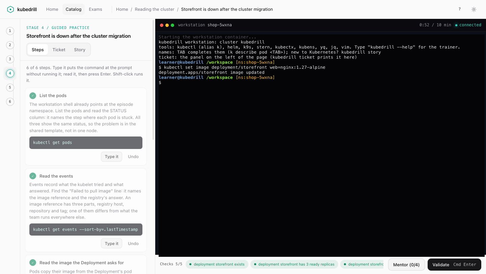

<h1>
  <picture>
    <source media="(prefers-color-scheme: dark)" srcset="docs/images/logo-dark.svg">
    
  </picture>
</h1>

[Source](https://github.com/cauebraz/kubedrill) /
[Issues](https://github.com/cauebraz/kubedrill/issues) /
[Contributing](CONTRIBUTING.md) /
[Docs](docs/)

Practice Kubernetes on the tickets platform and SRE teams get at work.

Each scenario breaks something in a kind cluster on your machine. You get a
ticket, you fix it with `kubectl`, and `kubedrill` grades the end state. Any
fix that works passes. No slides, no multiple choice.

## Quick start

You need Docker running. kind is built into the binary, the workstation
brings its own `kubectl`, and without Go 1.27.3 on `PATH` `./start.sh`
builds `kubedrill` inside a golang container, so there is nothing else to
install.

```sh
git clone https://github.com/cauebraz/kubedrill.git && cd kubedrill && ./start.sh
```

Or download a release archive: it holds the repository at that tag and a
prebuilt `bin/kubedrill`; extract it and run `./bin/kubedrill` from that
directory (Docker still required).

That is the only command to remember. `./start.sh` builds `kubedrill`,
checks your tools, creates a local cluster (Kubernetes v1.37.0, one control
plane, two workers) and opens the workspace in your browser at
`http://127.0.0.1:8642`. Next time, run `./start.sh` again: your progress
is kept. Ctrl-C in the terminal stops the workspace.

The first run downloads the kind node image (about 1 GB) and builds the
workstation image (about 800 MB) while the cluster starts. Both take a few
minutes, once. `up` also preloads the images the scenarios need,
so practice after it works without a registry. `kubedrill up --addons
gateway,kwok` adds Envoy Gateway and KWOK to the cluster.

## Your first assignment

The first visit opens a three-minute welcome: the five steps every ticket
follows (describe the symptom, two candidate causes, the observation that
splits them, one change, verify), each on a worked ticket with the reason it
exists. Then each assignment runs in the browser, in six stages:

1. **Meet the customer.** Chat with the person who opened the ticket and
   pick the questions a good engineer would ask. Each good question adds a
   requirement to your board, and a mentor comments on every choice.
2. **Check understanding.** A short quiz on what the symptoms mean.
3. **Learn the pieces.** A diagram of the objects involved and the story of
   the ticket told from zero.
4. **Guided practice.** A live namespace with the problem planted, a
   terminal into the workstation in the page, step-by-step instructions and
   checks that turn green as you fix things.
5. **Do it yourself.** The same ticket on another variant, no
   guide, and a mentor that gives hints one step at a time.
6. **Debrief and badge.** After each passed run the debrief puts your
   diagnosis next to the real cause and shows your trajectory: how much you
   observed before the first change, and whether that change hit the
   object the fix belongs to. Finish every DIY run of a learning plan to
   earn its badge.

The home page always has one next step: the run you left open, or the
assignment kubedrill recommends and why. The catalog filters every
assignment by level, status, exam domain and concept, and the exams page
shows how much of each CKA, CKAD and CKS domain you cover. Each assignment
also has an exam rehearsal: a random variant against the clock, no hints
and one Submit. Press `?` on any screen for its keyboard shortcuts.



Everything runs on your machine: the page talks to `kubedrill` on
`127.0.0.1` only, with a token from the link it prints.

## In the terminal

The terminal in the page is the workstation: `kubectl`, `helm`, `k9s` and
`stern`, already pointing at the scenario namespace. New to Kubernetes?
`kubedrill story` (or the Story tab) tells the ticket from zero: what each
object is, which commands follow the trail and why the fix works. Select
text with the mouse to copy it; TAB also completes names. When you are
stuck:

```sh
kubedrill hint                   # the next hint: where to look, what to observe, what it means
kubedrill diagnose "<cause>"     # name the cause in one line; the last hint and the solution wait for it
kubedrill check                  # grade once and see expected vs actual for each check
```

After a solve, kubedrill compares your diagnosis with the real root cause.
It asks which observation would have ruled out your first guess sooner.
Then `kubedrill list` shows the next scenario.

The method behind every scenario is one loop: describe the symptom, list
candidate causes, find the observation that splits them, change one thing,
verify. `kubedrill learn troubleshooting-loop` explains it.

## Documentation

| Read this                                            | When you want to                                              |
|------------------------------------------------------|---------------------------------------------------------------|
| [docs/study-flow.md](docs/study-flow.md)             | Understand grading, hints, the debrief, mastery and exam mode |
| [docs/workstation.md](docs/workstation.md)           | Learn the workstation terminal, tools and recording           |
| [docs/cli.md](docs/cli.md)                           | Look up a command, flag, message or exit code                 |
| [docs/concepts/](docs/concepts/README.md)            | Read about a mechanism a ticket uses                          |
| [CONTRIBUTING.md](CONTRIBUTING.md)                   | Write a scenario                                              |
| [docs/scenario-format.md](docs/scenario-format.md)   | Look up a scenario file or field                              |

## Scenario packs

Scenarios can come from other repositories. `kubedrill pack add <git url>`
fetches a pack (a `pack.yaml` plus a `scenarios/` tree in this
repository's format), pins it to a commit, lints it, lists every script it
would run on your machine and asks before enabling it. Its scenarios then
join the catalog and the ladder. `docs/scenario-format.md` describes
`pack.yaml`.

## Your data stays local

Your progress lives in `~/.local/share/kubedrill`. The workstation records
your shell commands and the cluster keeps an API audit log. kubedrill uses
them only for the debrief. Nothing is sent anywhere, and the grade never
reads them. Details are in
[docs/study-flow.md](docs/study-flow.md#telemetry).

## Contributing

New scenarios are welcome, especially ones you lived through. Start with
[CONTRIBUTING.md](CONTRIBUTING.md). Run `just check` before a pull request.

## License

[Apache-2.0](LICENSE) for the code and the scenarios; attributions in
[NOTICE](NOTICE). The upstream manifests vendored in `cluster/addons/` are
Apache-2.0 as well ([details](cluster/addons/README.md)); the browser
libraries in `internal/web/static/vendor/` (xterm.js, mermaid) keep their MIT
licenses ([details](internal/web/static/vendor/README.md)).
Contributions are accepted under the same license with a DCO sign-off
(the `-s` flag when committing, see [CONTRIBUTING.md](CONTRIBUTING.md)).
