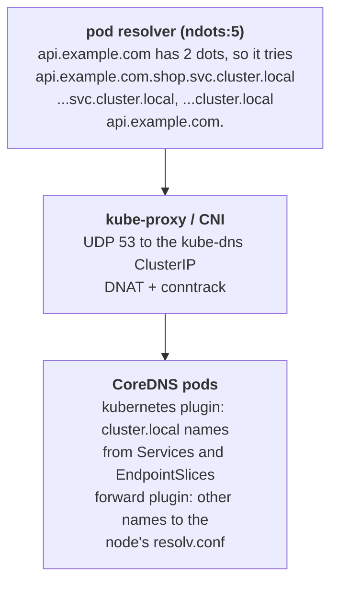

# Cluster DNS

k8s.af tags 9 of its 59 failure stories with DNS, 5 with CoreDNS, 4 with ndots and 6 with conntrack: the failures are capacity, search-path amplification and dropped UDP packets, not wrong records. Every pod with the default `dnsPolicy: ClusterFirst` sends its queries to the `kube-dns` Service, which load-balances to the CoreDNS pods in `kube-system`. The sentence to hold on call: when a name "does not resolve", first check that the target Service has ready endpoints, then that CoreDNS has endpoints, and only then look at DNS itself.

## The mechanism

The kubelet writes `/etc/resolv.conf` into each pod: `nameserver` is the ClusterIP of the `kube-dns` Service, `search` lists `<namespace>.svc.cluster.local svc.cluster.local cluster.local`, and `options ndots:5`. A name with fewer than 5 dots is tried with each search domain appended before it is tried as written.



So `api.example.com` costs 3 NXDOMAIN lookups before the real one, 6 extra queries when the resolver asks for A and AAAA records, 8 in total. A trailing dot (`api.example.com.`) or a lower `ndots` in `spec.dnsConfig.options` removes them.

`dnsPolicy` has four values: `ClusterFirst` (the default), `Default` (inherit the node's resolv.conf, so cluster names do not resolve), `ClusterFirstWithHostNet` (required for `hostNetwork: true` pods to use cluster DNS) and `None` (everything from `spec.dnsConfig`).

The default Corefile caches answers for 30 seconds (`cache 30`) and serves cluster records with a 30 second TTL. UDP queries pass through DNAT and conntrack; conntrack races drop some of them, and the client sees a delay of one resolver timeout before its retry (the NodeLocal DNSCache page cites timeouts of up to 30s: 3 retries + 10s timeout). NodeLocal DNSCache runs a DaemonSet cache on each node that skips DNAT and conntrack and can talk TCP to CoreDNS. CoreDNS replicas do not grow with the cluster unless the cluster-proportional autoscaler is installed (its documented example is `nodesPerReplica: 16`, `coresPerReplica: 256`).

## What you see on call

`kubectl exec -it <pod> -n <ns> -- nslookup <svc>.<ns>` tests resolution from the client's own namespace and resolv.conf:

```
Server:    10.96.0.10
Address:   10.96.0.10:53
Name:      db.shop.svc.cluster.local
Address:   10.96.143.22
```

`kubectl exec <pod> -n <ns> -- cat /etc/resolv.conf` shows the search list and `ndots` the pod actually uses.

`kubectl get endpointslices -n kube-system -l kubernetes.io/service-name=kube-dns` confirms CoreDNS has endpoints; add the ready jsonpath to see whether they are ready:

```
NAME             ADDRESSTYPE   PORTS        ENDPOINTS               AGE
kube-dns-x7k2p   IPv4          53           10.244.0.3,10.244.0.4   3d
```

`kubectl -n kube-system get pods -l k8s-app=kube-dns` lists the CoreDNS pods (the label keeps the old kube-dns name) and their restarts.

`kubectl -n kube-system logs -l k8s-app=kube-dns` shows plugin errors, for example upstream timeouts:

```
[ERROR] plugin/errors: 2 api.example.com. A: read udp 10.244.0.3:41234->172.18.0.1:53: i/o timeout
```

## Common failures

- `db.shop.svc` fails, `google.com` works -> the `db` Service has no ready endpoints or a different name or namespace -> `kubectl get endpointslices -n shop -l kubernetes.io/service-name=db`.
- Every lookup fails after a NetworkPolicy rollout -> egress to UDP and TCP 53 in `kube-system` not allowed -> `kubectl get networkpolicy -n <ns> -o yaml`.
- Lookups sometimes take several seconds, then succeed -> a UDP query dropped by a conntrack race and retried after the resolver timeout -> `kubectl exec <pod> -- time nslookup <name>` repeated 20 times.
- CoreDNS CPU high, latency grows with traffic -> ndots:5 multiplying external lookups and too few replicas -> `kubectl -n kube-system logs -l k8s-app=kube-dns` after enabling the `log` plugin, count NXDOMAIN for `*.svc.cluster.local` suffixes.
- `hostNetwork` pod cannot resolve cluster names -> `dnsPolicy: ClusterFirst` falls back to `Default` on host network -> `kubectl get pod <pod> -o jsonpath='{.spec.dnsPolicy}'`.
- CoreDNS in CrashLoopBackOff on nodes with systemd-resolved -> the `loop` plugin halts CoreDNS because `forward . /etc/resolv.conf` points at a local stub that forwards back -> `kubectl -n kube-system logs -l k8s-app=kube-dns --previous`.
- External names fail, cluster names work -> the upstream in `forward . /etc/resolv.conf` is unreachable -> `kubectl -n kube-system get configmap coredns -o yaml` and the i/o timeout lines in the logs.

## Go deeper

- https://kubernetes.io/docs/concepts/services-networking/dns-pod-service/ : records, the generated resolv.conf, `dnsPolicy` and `dnsConfig`.
- https://kubernetes.io/docs/tasks/administer-cluster/dns-debugging-resolution/ : the upstream debugging sequence with `nslookup`, endpoints and the `log` plugin.
- https://kubernetes.io/docs/tasks/administer-cluster/nodelocaldns/ : why skipping DNAT and conntrack helps and what the node cache changes.
- https://kubernetes.io/docs/tasks/administer-cluster/dns-custom-nameservers/ : the default Corefile, `cache 30` and `forward`.
