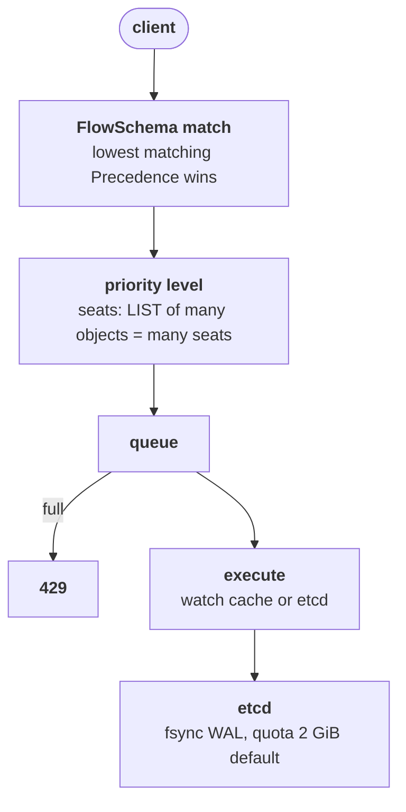

# Control plane signals

k8s.af tags 9 of its 59 failure stories with etcd and 6 with the API server, and almost none of them start with a crashed process: they start with a client that LISTs too much, an etcd disk that fsyncs too slowly, or a database that reached its quota. Upstream Kubernetes v1.37 is designed for at most 5,000 nodes, 150,000 pods and 300,000 containers, with SLOs of p99 1 s for mutating calls on one object, 30 s for a cluster-wide LIST and 5 s for stateless pod startup. The sentence to hold on call: a slow `kubectl get` is a queue somewhere, so read `/readyz`, the request counters and API Priority and Fairness before restarting anything.

## The mechanism

Every request passes API Priority and Fairness (APF, `flowcontrol.apiserver.k8s.io/v1`, GA in v1.29). A FlowSchema matches the request by user, group and verb and assigns it to a PriorityLevelConfiguration; each level owns a share of the server's concurrency (`--max-requests-inflight` plus `--max-mutating-requests-inflight`), counted in seats. A request that finds its level full waits in a queue; when the queue is full or the wait times out it gets HTTP 429 Too Many Requests.



A LIST that the server estimates returns many objects occupies more seats in proportion. A watch costs a seat only for its initial burst of notifications and then streams changes, so a client that re-LISTs every few seconds costs far more than one that watches. Defaults include `workload-low` (service accounts, 100 shares), `global-default` (other users, 20 shares) and `catch-all` (5 shares); `exempt` covers `system:masters`.

etcd stores every object and every Event. Its default space quota is 2 GiB (`--quota-backend-bytes`), with 8 GiB the suggested maximum; past the quota etcd raises a `NOSPACE` alarm and accepts only reads and deletes, and writes fail with `mvcc: database space exceeded`. etcd also needs fast disks: the etcd FAQ asks for a p99 `wal_fsync_duration_seconds` under 10ms, and slow fsync shows as leader changes and `apply entries took too long`. Events expire after `--event-ttl`, default 1h, so an Event storm grows the database for that hour.

## What you see on call

`kubectl get --raw '/readyz?verbose'` lists each check; a `[-]` line names the failing dependency:

```
[+]ping ok
[+]log ok
[-]etcd failed: reason withheld
[+]poststarthook/watch-cache-initialization ok
readyz check failed
```

`kubectl get --raw /metrics | grep '^apiserver_request_total'` counts requests by verb, resource and HTTP code; read 429 and 5xx:

```
apiserver_request_total{code="429",component="apiserver",dry_run="",group="",resource="pods",scope="cluster",subresource="",verb="LIST",version="v1"} 1843
```

`kubectl get --raw /metrics | grep apiserver_flowcontrol_rejected_requests_total` names the FlowSchema and priority level that reject, with `reason` one of `queue-full`, `concurrency-limit`, `time-out`, `cancelled`.

`kubectl get flowschemas,prioritylevelconfigurations` shows who maps where:

```
NAME                                PRIORITYLEVEL     MATCHINGPRECEDENCE
flowschema.../service-accounts      workload-low      9000
flowschema.../global-default        global-default    9900
NAME                                TYPE      NOMINALCONCURRENCYSHARES
prioritylevelconfiguration.../workload-low   Limited   100
```

`kubectl get --raw /metrics | grep apiserver_storage_size_bytes` reports the etcd database file size the API server sees, to compare with the quota.

## Common failures

- `kubectl get` takes seconds, 429s in client logs -> one client floods a priority level -> `apiserver_flowcontrol_rejected_requests_total` grouped by `flow_schema`.
- Controller in a service account starves while humans are fine -> service accounts outside kube-system share `workload-low`; kube-system service accounts go to `workload-high` -> `apiserver_flowcontrol_current_inqueue_requests{priority_level="workload-low"}`.
- Every write fails with `etcdserver: mvcc: database space exceeded` -> etcd reached its quota -> `etcdctl alarm list` shows `alarm:NOSPACE`.
- Leader elections and request latency spikes together -> slow etcd disk -> etcd logs `apply entries took too long` and the `etcd_disk_wal_fsync_duration_seconds` p99 above 10ms.
- etcd grows fast after a deploy -> an Event storm from a crash-looping workload -> `kubectl get events -A --no-headers | wc -l` against an hour earlier.
- 5xx on one resource only -> an admission webhook or aggregated API is down -> `kubectl get --raw /metrics | grep 'apiserver_request_total{code="5'` and `kubectl get apiservices`.
- `/readyz` fails on `etcd` -> the API server cannot reach etcd -> `kubectl get --raw '/readyz/etcd'`.

## Go deeper

- https://kubernetes.io/docs/concepts/cluster-administration/flow-control/ : FlowSchemas, priority levels, seats, defaults and the `apiserver_flowcontrol_*` metrics.
- https://kubernetes.io/docs/setup/best-practices/cluster-large/ : the 5,000 node envelope and a dedicated etcd for Events.
- https://kubernetes.io/docs/reference/using-api/health-checks/ : `/livez`, `/readyz` and the `verbose` and individual checks.
- https://github.com/kubernetes/kubernetes/blob/master/pkg/apis/flowcontrol/bootstrap/default.go : the suggested FlowSchemas (kube-system-service-accounts -> workload-high, service-accounts -> workload-low) and the nominal shares.
- https://github.com/kubernetes/community/blob/main/sig-scalability/slos/slos.md : the API call latency and pod startup SLOs.
