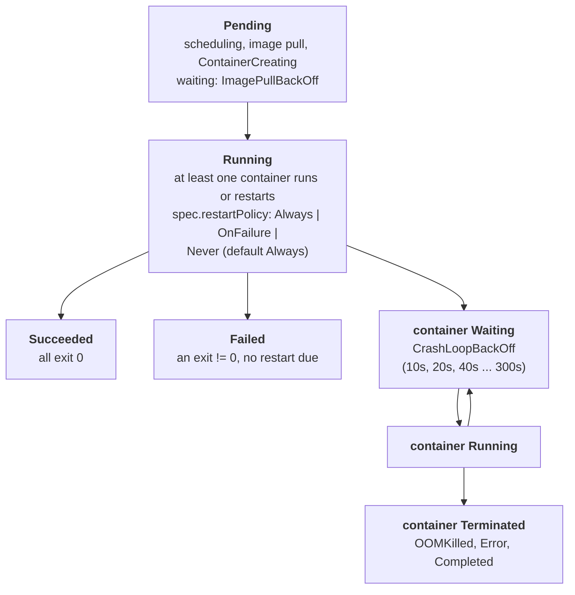

# Pod lifecycle

A pod moves through a phase (`Pending`, `Running`, `Succeeded`, `Failed`) while each of its containers moves through a state (`Waiting`, `Running`, `Terminated`) with a reason. The STATUS column of `kubectl get pods` is computed from the container states, not copied from the phase, so `CrashLoopBackOff` is a pod in phase `Running`. The sentence to hold on call: the phase says where the pod is, the container reason says why it is stuck, and the Events say what the kubelet tried.

## The mechanism

The scheduler binds the pod to a node; the kubelet on that node creates the sandbox, pulls images and starts containers, writing what it sees into `status`. `status.phase` is `Pending` until every container has been created, `Running` while at least one container runs or restarts, `Succeeded` when all containers exited 0 and will not restart, `Failed` when all exited and at least one failed without a restart due. `Unknown` appears when the node stops reporting.

Each entry in `status.containerStatuses[]` has `state.waiting`, `state.running` or `state.terminated`. `waiting.reason` carries `ContainerCreating`, `ImagePullBackOff`, `ErrImagePull` or `CrashLoopBackOff`; `terminated.reason` carries `Completed`, `Error` or `OOMKilled` with `exitCode` (137 for OOMKilled) and `restartCount` grows on each restart.



`restartPolicy` applies to the app containers and to regular init containers; sidecar containers (init containers with their own `restartPolicy: Always`) ignore it. With `Always` a container that exits, even with code 0, is restarted; each restart waits an exponential backoff (10s, 20s, 40s) capped at 300s, reset after 10 minutes of running. `status.conditions[]` carries at least `PodScheduled`, `Initialized`, `PodReadyToStartContainers`, `ContainersReady` and `Ready`; the last one is what Services wait for (see `readiness-and-endpoints`).

Events are separate objects: the kubelet and the scheduler write `Event`s whose `involvedObject` is the pod, and `describe` lists them: `Scheduled`, `Pulling`, `Pulled`, `Created`, `Started`, `BackOff`, `Failed`, `Killing`. The kube-apiserver deletes Events after `--event-ttl`, one hour by default, so an old failure can vanish from `describe` while `restartCount` still shows it.

## What you see on call

`kubectl get pods -n <ns> -o wide` shows the computed STATUS, `RESTARTS` with the age of the last restart, and the node:

```
NAME                     READY   STATUS             RESTARTS      AGE   NODE
hello-7c9f5b6d8-xk2lp    0/1     CrashLoopBackOff   5 (42s ago)   6m    kubedrill-worker
```

`kubectl describe pod <pod> -n <ns>` has the sections that matter in order: `Containers` (image, `State`, `Last State` with the previous `Reason` and `Exit Code`, `Restart Count`), `Conditions` and `Events`:

```
    State:          Waiting
      Reason:       CrashLoopBackOff
    Last State:     Terminated
      Reason:       OOMKilled
      Exit Code:    137
```

`kubectl get events -n <ns> --sort-by=.lastTimestamp` orders the narrative; the default order is not chronological:

```
LAST SEEN   TYPE      REASON    OBJECT                      MESSAGE
3m          Normal    Pulled    pod/hello-7c9f5b6d8-xk2lp   Successfully pulled image "nginx:1.27-alpine"
12s         Warning   BackOff   pod/hello-7c9f5b6d8-xk2lp   Back-off restarting failed container hello in pod hello-...
```

`kubectl logs <pod> -n <ns> --previous` prints the output of the terminated container, which is where a crash loop explains itself.

`kubectl get pod <pod> -n <ns> -o jsonpath='{range .status.containerStatuses[*]}{.name}{" "}{.state}{"\n"}{end}'` prints one line per container with its raw state when the STATUS column hides a detail; `-o jsonpath='{.status.phase}'` prints the phase.

`kubectl debug -it <pod> --image=busybox:1.37 --target=<container>` adds an ephemeral container (stable since v1.25) that shares the target's process namespace, for images without a shell; it is never restarted and cannot be removed from the pod:

```
Defaulting debug container name to debugger-8xzrl.
If you don't see a command prompt, try pressing enter.
/ #
```

## Common failures

- STATUS `ImagePullBackOff` or `ErrImagePull` -> the image reference cannot be pulled -> `kubectl describe pod <pod>` and read the `Failed` event message (see `image-pull`).
- STATUS `CrashLoopBackOff` with `Last State: Terminated, Exit Code: 1` -> the process exits on start (bad config, missing env, bad command) -> `kubectl logs <pod> --previous`.
- STATUS `CrashLoopBackOff` with `Reason: OOMKilled, Exit Code: 137` -> memory limit below real usage -> `kubectl get pod <pod> -o jsonpath='{.spec.containers[0].resources.limits.memory}'`.
- STATUS `Pending` with no node -> unschedulable (resources, taints, node selector) -> `kubectl describe pod <pod>` and read the `FailedScheduling` event.
- STATUS `ContainerCreating` for more than a minute -> a volume or secret the pod mounts does not exist -> `kubectl describe pod <pod>`, look for `FailedMount`.
- STATUS `Completed` on a Deployment pod -> the main process exits 0 and `restartPolicy: Always` restarts it into `CrashLoopBackOff` -> `kubectl get pod <pod> -o jsonpath='{.spec.containers[0].command}'`.
- STATUS `Running` but `READY 0/1` -> readiness probe failing -> `kubectl describe pod <pod>`, look for `Unhealthy` events (see `readiness-and-endpoints`).
- STATUS `Terminating` for minutes -> a finalizer or a process that ignores SIGTERM until `terminationGracePeriodSeconds` -> `kubectl get pod <pod> -o jsonpath='{.metadata.finalizers}{.metadata.deletionTimestamp}'`.

## Go deeper

- https://kubernetes.io/docs/concepts/workloads/pods/pod-lifecycle/ : the phase and container state definitions, the restart backoff numbers and the pod conditions.
- https://kubernetes.io/docs/tasks/debug/debug-application/debug-pods/ : the debugging sequence the project's L0 scenarios follow.
- https://github.com/kubernetes/kubernetes/blob/master/pkg/printers/internalversion/printers.go : `printPod`, the code that computes the STATUS column from container states.
- https://kubernetes.io/docs/reference/command-line-tools-reference/kube-apiserver/ : `--event-ttl`, the retention of Events (default 1h0m0s).
