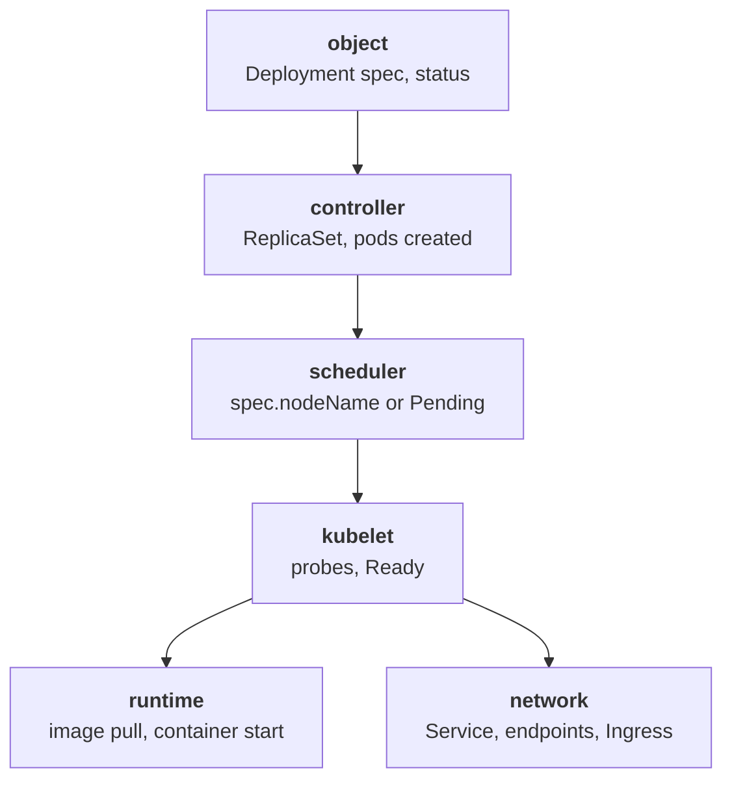

# Troubleshooting loop

Technicians trained in a fixed troubleshooting loop plus a functional model of the system solved about twice as many malfunctions, in less time, as those trained the traditional way (Schaafstal, Schraagen and van Berlo 2000). The loop has five steps: describe the symptom, list candidate causes, pick the observation that splits them, change one thing, verify. The sentence to hold on call: write down two causes before you run the second command, and stop the user impact before you look for the root cause.

## The mechanism

Novices form a hypothesis from the first error they read, then keep collecting evidence for it and add new faults while they hunt (Vessey 1985; Gugerty and Olson 1986). The loop counters that by forcing a list before any action:

1. Describe the symptom as an observable fact: "deployment hello: 0/2 ready since 09:10".
2. List at least two candidate causes, one per layer of the model below.
3. Pick the one command whose output differs between the candidates.
4. Change one thing, the smallest change that removes one cause.
5. Verify against the original symptom, not against the change.

The functional model is the chain a request for a running pod walks through. Each layer has its own object, its own status field and its own Events:



A failure stops the chain at one layer, so the first useful question is "how far did it get". Pending stops at the scheduler, `ErrImagePull` at the runtime, Running with READY 0/1 at the kubelet probe, Ready with no traffic at the network. For traffic problems the learnk8s flowchart orders the checks bottom-up: start with the Pods and move up the stack with Service and Ingress.

Mitigation comes first. The Google SRE Workbook states that first responders prioritize mitigation and that mitigating needs only the location of the cause, not its details. On Kubernetes that is usually `kubectl rollout undo` or a scale-up; the root cause is analyzed after the impact stops (see `what-changed`).

## What you see on call

`kubectl get deploy,rs,pods -n <ns> -o wide` answers "how far did it get" in one screen:

```
NAME                    READY   UP-TO-DATE   AVAILABLE
deployment.apps/hello   0/2     2            0
NAME                               DESIRED   CURRENT   READY
replicaset.apps/hello-7c9f5b6d8    2         2         0
NAME                        READY   STATUS             RESTARTS
pod/hello-7c9f5b6d8-xk2lp   0/1     ImagePullBackOff   0
```

`kubectl describe pod <pod> -n <ns>` names the layer that stopped in `Events`, with the component in the `From` column (lines from two different pods):

```
Warning  Failed     kubelet            Failed to pull image "nginx:1.27-alpne"
Warning  FailedScheduling  default-scheduler  0/3 nodes are available
```

`kubectl get events -n <ns> --sort-by=.lastTimestamp` gives the order of facts, which separates cause from consequence:

```
LAST SEEN   TYPE      REASON              OBJECT
9m          Normal    ScalingReplicaSet   deployment/hello
8m          Warning   Failed              pod/hello-7c9f5b6d8-xk2lp
```

`kubectl get endpointslices -n <ns> -l kubernetes.io/service-name=<svc>` is the split between the pod layers and the network layers: endpoints with `conditions.ready=true` mean the pods are fine and the problem is above the Service; addresses alone do not, because not-ready pods are listed too.

```
NAME          ADDRESSTYPE   PORTS   ENDPOINTS                AGE
hello-8kz2n   IPv4          80      10.244.1.7,10.244.2.4    8m
```

`kubectl port-forward svc/<svc> 8080:80 -n <ns>` then `curl localhost:8080` tests the Service without the Ingress, the next split upward.

## Common failures

- Restart first, then nothing to read -> deleting the pod discarded `Last State` and the previous logs; the replacement pod has none -> `kubectl logs <new-pod> --previous` returns `previous terminated container "<name>" in pod "<new-pod>" not found`.
- Two fixes at once, symptom gone, cause unknown -> step 4 skipped -> `kubectl rollout history deployment/<name>` shows two revisions within minutes.
- Hours on DNS while the Service had no endpoints -> anchored on the first error message -> `kubectl get endpointslices -l kubernetes.io/service-name=<svc>`.
- Fix verified against the change ("the image is updated") while users still fail -> step 5 checked the wrong fact -> `kubectl get deploy <name>` READY column against the ticket.
- Root cause analysis during an outage, impact continues -> mitigation skipped -> `kubectl rollout undo deployment/<name>` then `kubectl rollout status deployment/<name>`.
- Ingress blamed while pods are not Ready -> top-down order -> `kubectl get pods -n <ns>` READY column.

## Go deeper

- https://journals.sagepub.com/doi/10.1518/001872000779656570 : Schaafstal, Schraagen and van Berlo 2000, structured troubleshooting with a multi-level functional decomposition.
- https://learnkube.com/troubleshooting-deployments : the bottom-up flowchart for Pods, Services and Ingress.
- https://sre.google/workbook/incident-response/ : why first responders mitigate before root cause.
- https://kubernetes.io/docs/tasks/debug/debug-application/ : the upstream debugging tasks per layer.
