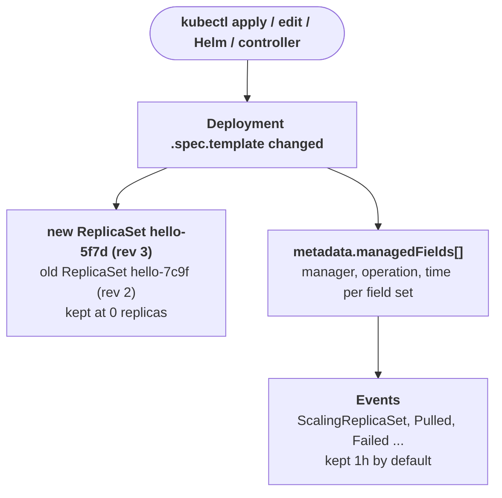

# What changed

79% of production incidents follow a recent change, according to Komodor's 2025 report as quoted in its press release (a secondary source; the report itself was not read). Kubernetes keeps three records of change you can read without any extra tooling: the Deployment's revisions stored as ReplicaSets, the Events timeline, and `metadata.managedFields` naming which manager last wrote each field. The sentence to hold on call: ask "what changed and when" before "what is wrong", and if the change lines up with the start of the symptom, roll it back first and analyze second.

## The mechanism

A Deployment rollout starts if and only if `.spec.template` changes. Each rollout creates a new ReplicaSet named `<deployment>-<pod-template-hash>` and annotated `deployment.kubernetes.io/revision=<n>`; scaling does not create a revision. The old ReplicaSets are kept at 0 replicas, up to `.spec.revisionHistoryLimit` (default 10), and they are the history: `kubectl rollout undo` copies the template of an old ReplicaSet back into the Deployment, which is itself a new revision.



Every write to an object records an entry in `metadata.managedFields` with `manager` (for example `kubectl-client-side-apply`, `kubectl-edit`, `kube-controller-manager`), `operation` (`Apply` or `Update`), `time` and the field set it owns. The entry tells you who changed a field and roughly when, even for objects without revisions such as ConfigMaps or Services. Events give the order of what followed; the API server keeps them for `--event-ttl`, default 1h, so an incident older than that has lost its Events.

`kubectl diff -f <file>` compares the live object with the version that applying the local manifest would produce and exits 1 when differences exist, which shows whether the cluster drifted from Git.

## What you see on call

`kubectl rollout history deployment/<name> -n <ns>` lists revisions; `CHANGE-CAUSE` comes from the `kubernetes.io/change-cause` annotation:

```
REVISION  CHANGE-CAUSE
2         <none>
3         image updated to 2.4.1
```

`kubectl rollout history deployment/<name> --revision=3` prints that revision's template, to compare images, env and probes with the previous one.

`kubectl get rs -n <ns> -l app=<name>` shows which ReplicaSet is live and how old each is:

```
NAME               DESIRED   CURRENT   READY   AGE
hello-5f7d9c6b4    2         2         0       6m
hello-7c9f5b6d8    0         0         0       3d
```

`kubectl get events -n <ns> --sort-by=.lastTimestamp` gives the timeline to line up with the alert:

```
LAST SEEN   TYPE      REASON              OBJECT                 MESSAGE
6m          Normal    ScalingReplicaSet   deployment/hello       Scaled up replica set hello-5f7d9c6b4 from 0 to 1
5m          Warning   BackOff             pod/hello-5f7d9c6b4-q8   Back-off restarting failed container
```

`kubectl get cm <name> -n <ns> -o yaml --show-managed-fields` shows who wrote what:

```
  managedFields:
  - manager: kubectl-edit
    operation: Update
    time: "2026-10-25T09:02:11Z"
    fieldsType: FieldsV1
```

`kubectl rollout undo deployment/<name> -n <ns>` mitigates; `--to-revision=<n>` picks a specific one.

## Common failures

- Rollback did not fix it -> the change was outside the pod template (a ConfigMap, a Service, a NetworkPolicy) -> `kubectl get <kind> <name> -o yaml --show-managed-fields` and read the newest `time`.
- `rollout undo` fails with no revision to roll back to -> `revisionHistoryLimit: 0` deleted the old ReplicaSets -> `kubectl get deploy <name> -o jsonpath='{.spec.revisionHistoryLimit}'`.
- Rolled back, then the next GitOps sync reapplied the bad version -> the cluster was fixed but Git was not -> `kubectl diff -f <manifest>` after the sync.
- Pods restarted with no new revision -> a ConfigMap or Secret consumed by the app changed, or a node was drained -> `kubectl get events -A --sort-by=.lastTimestamp` around the restart time.
- Events empty for an incident from this morning -> older than `--event-ttl` (1h) -> rely on `managedFields` times and ReplicaSet ages instead.
- Two teams change the same field back and forth -> two managers own it -> `managedFields` lists both with alternating `time`.

## Go deeper

- https://kubernetes.io/docs/concepts/workloads/controllers/deployment/ : rollout triggers, revision history, `rollout undo` and `revisionHistoryLimit`.
- https://kubernetes.io/docs/reference/using-api/server-side-apply/ : `managedFields`, managers, operations and `--show-managed-fields`.
- https://kubernetes.io/docs/reference/kubectl/generated/kubectl_diff/ : `kubectl diff` and its exit codes.
- https://www.businesswire.com/news/home/20250917424603/en : the Komodor 2025 figure on changes preceding incidents.
