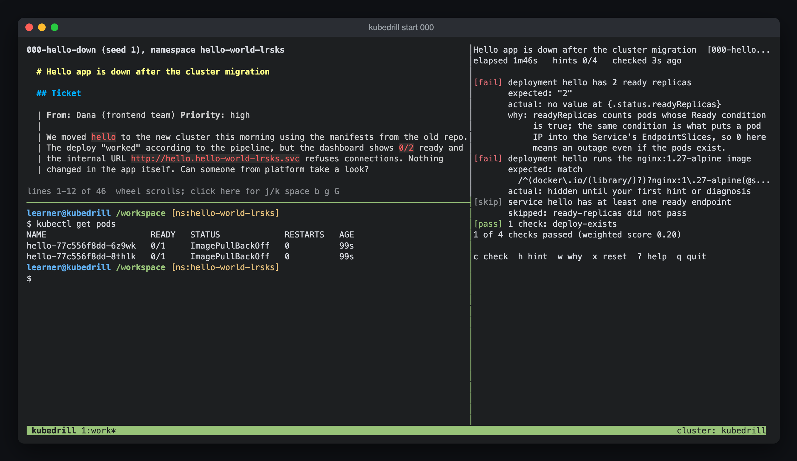

# Workstation

The workstation is the terminal you work in. It is a Docker container with
the Kubernetes tools installed, connected to the training cluster. Like the
remote terminal of the CKA exam, it is the same environment on every
machine.

`kubedrill start <id>` opens it for you. On the host you only need Docker,
`kubectl` and a Go toolchain that satisfies `go.mod`; Go cross-compiles the
linux `kubedrill` binary the container uses.

## What you see

With an active episode and a terminal of at least 120 columns, the
workstation opens a tmux session with three panes:



```
+--------------------------------+---------------------+
| ticket                         | kubedrill watch     |
|  (kubedrill ticket --follow)   |  checks, re-graded  |
|  scrolls on its own            |  every 5 s          |
+--------------------------------+                     |
| shell  <- the keyboard is here |                     |
|  kubectl, helm, k9s, ...       |                     |
+--------------------------------+---------------------+
 kubedrill 1:work*                     cluster: kubedrill
```

- Left column, 60% of the width: the ticket on top (45% of the height) and
  the shell below.
- Right column, 40%: `kubedrill watch`. Its keys are in
  [cli.md](cli.md#watch-keys).
- Status line: the cluster name.

Read on the top, work on the bottom, glance at the right.

### Moving around

- Scroll the ticket: move the mouse over it and use the wheel. The keyboard
  stays in the shell, and typing there never moves the ticket.
- Scroll with keys: click the ticket pane, then use `j`/`k` (one line),
  `space`/`b` (one page) and `g`/`G` (top, end). Click the shell to type
  again.
- Zoom one pane to the full window: `Ctrl-b z`, and again to restore.
- Resize panes: drag the border with the mouse.
- Copy text from the ticket: hold Option (macOS terminals) or Shift
  (elsewhere) while you select, or run `kubedrill ticket` in the shell to
  print a copy.

The ticket pane follows the episode. After `x` twice in the watch pane, or
`kubedrill reset`, it shows the new ticket from the top. The shell switches
to the new namespace at its next prompt.

### Smaller terminals and other layouts

| Situation                         | What opens                                              |
|-----------------------------------|---------------------------------------------------------|
| Under 120 columns                 | A plain shell, no tmux; it prints the ticket on login   |
| Under 30 lines                    | tmux without the ticket pane; the shell prints the ticket |
| No active episode                 | tmux with the shell only                                |
| `--layout shell`                  | A single login shell, no tmux                           |
| `kubedrill` binary not mounted    | `kubedrill binary not mounted at /usr/local/bin/kubedrill; starting a plain shell` |

Exiting the shell ends the session and the container. Quitting the ticket
or watch pane leaves a bash in its place; exiting that bash closes only
that pane.

## The shell

On login the shell:

- prints the banner `kubedrill workstation: cluster kubedrill` and `tools:
  kubectl (alias k), helm, k9s, stern, kubectx, kubens, yq, jq, vim. Type
  "kubedrill --help" for the trainer.`;
- prints `ticket: the pane above (mouse wheel scrolls it; kubedrill ticket
  prints it here)` when the ticket pane is open (`KUBEDRILL_TICKET_PANE=1`),
  and the full ticket (`kubedrill ticket`) otherwise;
- points `kubectl` at the episode namespace, so `k get pods` needs no `-n`.

The prompt shows that namespace: `learner@kubedrill /workspace
[ns:hello-world-k3x9p]`.

Other settings from `workstation/bashrc`: `alias k=kubectl` with
completion, helm and `kubedrill` completion, `KUBE_EDITOR=vim`.

All `kubedrill` commands work inside the workstation (`ticket`, `check`,
`hint`, `watch` and the rest), because the binary and the journal are
mounted.

### How the namespace is set

The kubeconfig is mounted read-only. With an active episode, the shell
copies it to `/tmp/kubeconfig` and sets the episode namespace (`kubedrill
namespace`) on the current context. A `PROMPT_COMMAND` hook compares that
namespace with `kubedrill namespace` before every prompt, so a reset is
picked up at the next prompt.

## Tools

Debian bookworm-slim (pinned by digest in `workstation/Dockerfile`), user
`learner` (uid 1000), home `/home/learner`, workdir `/workspace`.

| Tool            | Version | Source                                                  |
|-----------------|---------|---------------------------------------------------------|
| kubectl         | v1.37.1 | dl.k8s.io (same minor as `cluster/profiles/base.yaml`)  |
| helm            | v4.3.1  | get.helm.sh                                             |
| k9s             | v0.51.0 | github.com/derailed/k9s                                 |
| stern           | v1.35.0 | github.com/stern/stern                                  |
| kubectx, kubens | v0.11.0 | github.com/ahmetb/kubectx                               |
| yq              | v4.54.1 | github.com/mikefarah/yq                                 |
| asciinema       | v3.2.1  | github.com/asciinema/asciinema                          |

From Debian bookworm through apt, versions pinned in the Dockerfile: jq,
vim (vim-tiny), tmux, git, less, bash-completion, dnsutils, ping, nc, ssh,
curl, ca-certificates, procps.

## Commands that open it

| Command                     | What it does                                                             |
|-----------------------------|--------------------------------------------------------------------------|
| `kubedrill start <id>`      | Starts the episode and opens the workstation with its ticket             |
| `kubedrill shell`           | Opens a new workstation for the active episode, or the tools without one |
| `kubedrill node <name>`     | Opens a shell on a kind node: `control-plane`, `worker` or `worker2`     |
| `kubedrill replay [episode-id]` | Plays the latest recording of an episode                             |

- `start` prints on the host `ticket shown in the workstation (kubedrill
  ticket reprints it)`, the Fundamentals line and the ticket footer.
  `--no-shell` stays on the host and prints the ticket there.
- Every `shell` call starts a new container and a new tmux session. The
  container runs with `--rm`, so the previous session is gone; the episode
  and the cluster are untouched.
- `--layout shell` opens one login shell without tmux. `--exam` opens the
  exam workstation, which is automatic during an exam episode.
- `node` runs `docker exec` into the kind node container, for kubelet,
  containerd and systemd scenarios.

## What is recorded

The workstation is where kubedrill learns what you ran. The API side comes
from the cluster audit log ([study-flow.md](study-flow.md), Telemetry).
Nothing leaves your machine, and the checks never read these files.

- Shell log: one JSON line per command in `/data/shell/commands.jsonl`,
  which is `<journal dir>/shell/commands.jsonl` on the host:
  `{"ts":"2026-10-25T14:03:11.120Z","cmd":"kubectl get pods","exit":0,"ms":180}`.
  kubedrill reads it when an episode ends, to count commands and list the
  kubectl lines of "your path". Over 10 MiB it moves to
  `commands.jsonl.1` after that read.
- Recording: while an episode is active and stdin is a terminal, the shell
  runs under asciinema and writes
  `/data/recordings/<namespace>-<unix>.cast`. Idle time over 2 seconds is
  capped. `kubedrill replay` plays it.

Commands typed on the host are not in the shell log. They reach the
debrief through the audit log alone.

## Exam mode

`kubedrill start <id> --exam` opens the exam workstation for the episode.
`kubedrill shell --exam` opens it without one. Differences:

- No `kubedrill watch` pane. The ticket pane stays, as the real exam shows
  the question next to the terminal.
- `PATH` is `/opt/exam/bin:/usr/bin:/bin`. `/opt/exam/bin` holds `kubectl`,
  `helm`, `yq`, `kubedrill` and `vim`; `jq` and the Debian tools come from
  `/usr/bin`. `k9s`, `stern`, `kubectx` and `kubens` stay in
  `/usr/local/bin`, off the `PATH`.
- The banner reads `EXAM MODE: use kubectl (k), helm, yq, jq and vim, as in
  the real exam. No hints, no solution, no watch pane.` It lists the allowed
  documentation (https://kubernetes.io/docs, https://kubernetes.io/blog,
  https://helm.sh/docs, https://gateway-api.sigs.k8s.io) and prints the
  deadline with `Run "kubedrill submit" when done.`

Exam mode rehearses the conditions; it is not a sandbox. A full path such
as `/usr/local/bin/k9s` still runs, and the repository, solutions included,
stays readable at `/workspace/repo` (see Accepted risks).

## Limits

- Docker is required. Without the daemon, `kubedrill shell` fails with
  `the workstation needs docker: docker is not available (is Docker Desktop
  or the daemon running?): docker info: <docker's message>: <exit status>`,
  so a permission problem on the docker socket shows its own text.
- The cluster must run on docker. Without the `kind` network it fails with
  `kind docker network not found; was the cluster created with docker?
  (kubedrill up)`.
- The first build downloads the base image, the apt packages and eight
  binaries (kubectl, helm, k9s, stern, kubectx, kubens, yq, asciinema). It
  needs the network once per image tag.
- The host Go must satisfy `go.mod`. The image carries no Go.
- Files written outside `/data` are gone when the session ends.
- On Linux the kind API server can write the audit log as root. The
  workstation runs with your uid and reads the log only when you can. `ls
  -l ~/.local/state/kubedrill/kubedrill/audit/audit.log` shows the owner and
  mode; an unreadable log gives `unknown` verdicts.

---

The sections below are reference for readers who want to know how the
container is built and started.

## How it is wired

`internal/workstation` starts the container with these mounts:

| Container path               | Host source                                                                 | Mode       |
|------------------------------|-----------------------------------------------------------------------------|------------|
| `/workspace/repo`            | repository root                                                             | read-only  |
| `/data`                      | journal directory (`~/.local/share/kubedrill`)                              | read-write |
| `/home/learner/.kube/config` | `<cluster state dir>/kubeconfig-internal`, written by `cluster.Manager.WriteInternalKubeconfig` | read-only |
| `/usr/local/bin/kubedrill`   | `<cluster state dir>/bin/kubedrill-linux-<arch>-<hash>`, built by `EnsureBinary` | read-only |
| `/audit`                     | cluster audit directory (`cluster.AuditDir()`, `~/.local/state/kubedrill/kubedrill/audit` by default), only when it exists | read-only |

The cluster state directory is `~/.local/state/kubedrill/kubedrill` (under
`XDG_STATE_HOME` when set), outside the journal. The journal directory is
mounted read-write, so `kubedrill` refuses to start the workstation when it
overlaps something the host later trusts: a kubeconfig or binary inside it,
or the repository or the state directory inside it, or the journal inside
either of them.

Environment:

| Variable                  | Value                                              |
|---------------------------|----------------------------------------------------|
| `KUBEDRILL_ROOT`          | `/workspace/repo`                                  |
| `KUBEDRILL_DATA`          | `/data`                                            |
| `KUBECONFIG`              | `/home/learner/.kube/config`                       |
| `KUBEDRILL_WORKSTATION`   | `1`                                                |
| `KUBEDRILL_CLUSTER`       | the cluster name                                   |
| `KUBEDRILL_NO_TERM_QUERY` | `1`: the kubedrill inside never queries the terminal for colors |
| `TERM`                    | passed through                                     |
| `KUBEDRILL_AUDIT_LOG`     | `/audit/audit.log`, when the audit directory is mounted |
| `KUBEDRILL_EXAM`, `KUBEDRILL_DEADLINE` | `1` and the deadline in RFC 3339 UTC, in exam mode |

Network: the container joins the `kind` docker network with hostname
`kubedrill`. Its kubeconfig points at `https://kubedrill-control-plane:6443`
instead of the host's `127.0.0.1` port, which is why it gets its own
kubeconfig file.

Hardening flags, on every workstation and replay container:

```
--security-opt no-new-privileges --cap-drop ALL --pids-limit 512 --memory 2g --init
```

No capability is added back. The image strips the file capability of `ping`
(`setcap -r`), which then uses an unprivileged ICMP socket
(`net.ipv4.ping_group_range`, open to every group in a docker container).

- `kubedrill replay` adds `--network none` and mounts the journal
  read-only.
- On Linux hosts both add `--user <uid>:<gid>` and `HOME=/home/learner`, so
  files written under `/data` belong to you. The image leaves
  `/home/learner` and `/home/learner/.kube` at mode 0777 so that mapped user
  can write there.

### Shell log and recording details

- The shell log comes from a DEBUG trap and a `PROMPT_COMMAND` in
  `bashrc`. The command line is taken from history
  (`HISTCONTROL=ignoredups`).
- The recording runs `asciinema rec --quiet -i 2
  /data/recordings/<namespace>-<unix>.cast -c '<restore umask and TERM>;
  exec bash -l'`. asciinema itself runs with `TERM=dumb`: with an xterm-like
  `TERM` it sends OSC 10, 11 and 4 color queries whose late answers leak
  into the shell as typed text (`]10;rgb:...`). The recorded shell gets the
  real `TERM` and umask back.
- `internal/workstation` creates `<journal dir>/shell` and
  `<journal dir>/recordings` with mode 0700 before the container starts.
  The entrypoint and `bashrc` keep both at 0700 and write the log and the
  `.cast` files with mode 0600 (umask 077). The learner's umask is otherwise
  left as it is.

### Image and binary

- Image tag: `kubedrill-workstation:<12 hex>`, a sha256 over the six files
  in `workstation/`. Changing any of them changes the tag, so the next
  `kubedrill shell` builds the new image. Maintainer notes are in
  [workstation/README.md](../workstation/README.md).
- `EnsureImage` runs `docker image inspect` and builds only when the tag is
  missing, with `docker build --progress quiet`. It prints `rebuilding
  workstation image <tag> (sources changed)...` when any other
  `kubedrill-workstation:<12 hex>` tag exists, whatever its age,
  `building workstation image <tag> (first time only, a few minutes)...`
  otherwise, and `workstation image
  <tag> built in <elapsed>` at the end.
- After a build it removes older `kubedrill-workstation:<12 hex>` tags and
  prints `removed <n> older workstation image(s)`. It never removes the
  current tag, a tag created within the last seven days (a parallel checkout
  may use it), untagged images or tags that are not 12 hex digits (such as
  `dev`).
- The docker queries (`info`, `image inspect`, `image ls`, `network
  inspect`, `inspect`) give up after 10 seconds and keep docker's error
  text. The build and the interactive sessions have no timeout; cancelling
  the build kills its whole process group.
- A session that ends with status 126 or 127 counts as a docker failure
  only when docker printed a message; otherwise it is the status of your
  last shell command and is not reported.
- `EnsureBinary` cross-compiles `cmd/kubedrill` with `GOOS=linux
  CGO_ENABLED=0 -trimpath -buildvcs=false` for the host architecture on
  every run; the Go build cache makes an unchanged tree a no-op of about
  0.2 s, and a deleted source file is never left in a stale binary.

### tmux layout

`workstation/entrypoint.sh` takes `shell` (one login shell) or `tmux`. For
`tmux` it creates the session with the shell pane, then splits:

- `kubedrill watch; exec bash -l` to the right at 40%, outside exam mode,
  while an episode is active;
- `kubedrill ticket --follow; exec bash -l` above the shell at 45%, while an
  episode is active and the terminal has at least 30 lines, in exam mode
  too.

The shell pane gets `KUBEDRILL_TICKET_PANE` (1 or 0) and the keyboard. A
`pane-exited` hook ends the session only when the exited pane is the shell
pane. The container exits 0 when the shell ends.

## Accepted risks

- Read-only mounts protect against mistakes, not against a learner with host
  access. The internal kubeconfig and the linux binary live in the cluster
  state directory, outside `/data`, and are mounted read-only, so a process
  in the container cannot edit what the next `kubedrill shell` mounts. The
  `:ro` mounts stop an `rm -rf` in the wrong directory or a `kubectl config`
  write.
- `/data` is read-write. A process in the container can edit the shell log
  and the recordings, which only changes your own debrief.
- The kubeconfig holds only the `kind-kubedrill` context, so the exposure is
  the local cluster.
- The repository is readable at `/workspace/repo` in every mode, exam
  included, so `solution/` and `checks.yaml` of the running scenario can be
  read from the shell. Exam mode does not hide the answer from a learner who
  looks for it.
- The `gateway` addon (`cluster/addons/gateway/addon.yaml`) runs
  `cloud-provider-kind` as a docker container with `/var/run/docker.sock`
  mounted, because it assigns LoadBalancer addresses through the docker
  daemon that runs the kind nodes. That container has the same power over
  the host's docker as you. It is an upstream requirement, pinned by image
  digest, started only by `kubedrill up --addons gateway`, and not reachable
  from the workstation container.
