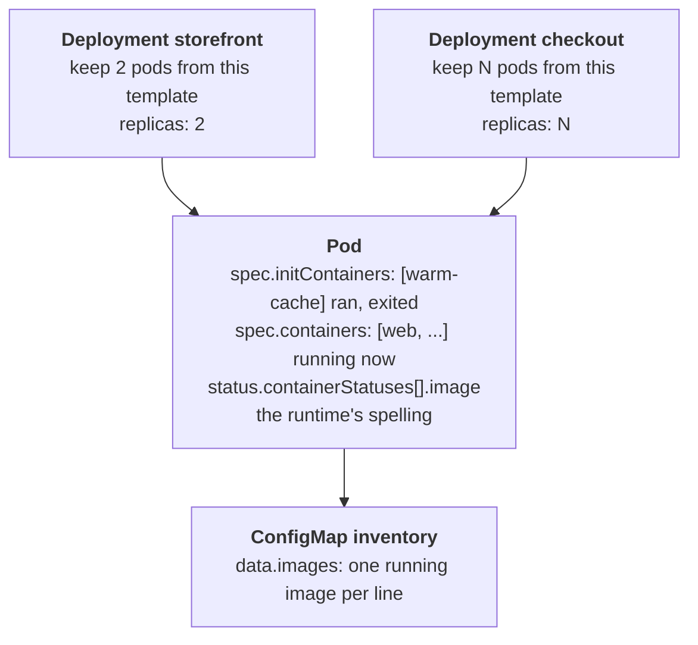

# The inventory that read the wrong list

## What happened

Marco from ops has to tell the security team which container images run in
the `shop` namespace. A container image is the packaged program a container
runs, named by a string such as `nginx:1.27-alpine`. Security compares those
strings with a list of approved ones, so Marco wants them written down in
the cluster itself, in a small object called a ConfigMap, where an audit job
can read them.

Nothing is broken in this ticket. The trap is that the cluster holds the
same image string in several places, and most of them are wrong for this
question. A Deployment says what should run, not what does; a finished init
container's image is on disk but not running; the status of a pod spells the
image differently from its spec. Someone who copies the first list they see
hands security an inventory that is wrong by one line, and nobody notices
until the audit flags an image that runs nowhere, or misses one that does.

## The pieces

Kubernetes keeps the cluster looking like the YAML you gave it. The objects
in this ticket, from the top down:

- Deployment: the wish, "keep N copies of this pod running". Its
  `spec.template` is the blueprint, image included. `spec.replicas` is N,
  and N can be 0: the Deployment exists, its blueprint names an image, and
  nothing runs.
- Pod: one running copy. It holds one or more containers in
  `spec.containers`, each with its own image. Two containers in one pod
  (an app and a log shipper, say) mean two images running.
- Init container: listed in `spec.initContainers`. It runs before the main
  containers, does one job and exits. After that, its image is not running,
  even though the pod still shows it.
- ConfigMap: a bag of key-value strings other things can read. The ticket
  asks for one named `inventory` with one key, `images`.



The question "which images are running" is answered by the `spec.containers`
line of the Pod box, over the pods that exist.

## Following the trail

Every command here only reads. In the workstation the namespace is already
set, so plain `kubectl` (or `k`) works; the full form is shown once.

Start with what should run and what does:

```sh
kubectl -n {{ .Namespace }} get deployments
kubectl get pods
```

`get deployments` lists five names with a READY column such as `2/2` or
`0/0`. A `0/0` Deployment has no pod. `get pods` lists the pods that exist,
with READY as `1/1` or `2/2`: the second number is how many containers the
pod has.

Next, read the image of every container of every pod in one call. The
`-o jsonpath` output format picks fields out of the objects; `range` walks
a list, `{"\n"}` prints a line break:

```sh
kubectl get pods -o jsonpath='{range .items[*]}{.metadata.name}{"\t"}{.spec.initContainers[*].image}{"\t"}{.spec.containers[*].image}{"\n"}{end}'
```

One line per pod: the name, the init image (empty for most pods), the main
images. This line answers which trap this episode set: a Deployment that is
in `get deployments` but has no line here is scaled to zero; a line with two
main images is a pod with two containers; an image ending in `@sha256:...`
is pinned by digest and must be copied whole.

Compare with what `describe` shows:

```sh
kubectl describe pod <pod-name>
```

Use TAB to complete the name, or `-l app.kubernetes.io/name=worker` to pick
by label. The `worker` pod has an `Init Containers:` block whose state reads
`Terminated` with reason `Completed`: it ran and finished. The `Containers:`
block below it is what runs. The `Image:` lines in `describe` may read
`docker.io/library/nginx:1.27-alpine` while the spec says
`nginx:1.27-alpine`: that is the runtime's spelling, and security compares
the spec's.

## The fix and why it works

Nothing changes in the Deployments. Build the list from the pods'
`spec.containers` and store it:

```sh
kubectl get pods --field-selector=status.phase=Running -o jsonpath='{range .items[*]}{range .spec.containers[*]}{.image}{"\n"}{end}{end}' | sort -u > images.txt
kubectl create configmap inventory --from-file=images=images.txt
```

Why this works: the outer `range` visits every pod in phase Running, the
inner one every main container, and `.image` prints the exact spec string.
`sort -u` sorts the lines and removes duplicates (two Deployments run the
same agnhost image). `--from-file=images=images.txt` stores the file's
content under the key `images`; the part before `=` is the key name.

Why the tempting moves do not work:

- Reading the Deployments: a Deployment at 0 replicas names an image that
  runs nowhere, and it would land in the inventory.
- Copying from `describe` or from `status.containerStatuses`: the runtime
  spells the image with its registry and library prefix, or as a bare
  `sha256:` digest, and the audit's string compare fails.
- Including the init container: it already exited; the ticket asks for
  what runs now.
- `--from-file=images.txt` without `images=`: the key becomes `images.txt`,
  and the audit reads an empty `images`.

## Check your work

```sh
kubectl get configmap inventory -o jsonpath='{.data.images}{"\n"}'
kubectl get pods -o jsonpath='{range .items[*]}{.metadata.name}{"\t"}{.spec.containers[*].image}{"\n"}{end}'
```

The first prints the stored lines; the second prints the running images per
pod. Every image in the second output appears exactly once in the first,
and nothing else does. The checks below the terminal turn green, and
`kubedrill check` grades once from the shell.

The habit to keep: when a question says "running", read the pods, not the
objects that describe what should run, and read `spec`, not `status`, when
a string has to match the manifest.
