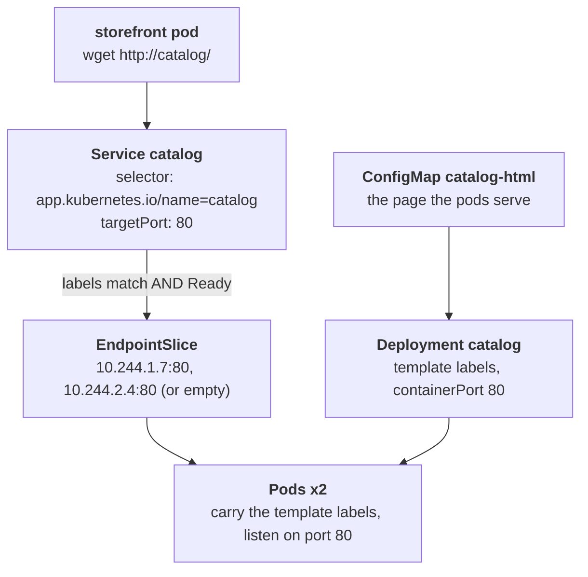

# The catalog that moved in next door

## What happened

Ravi's team runs the catalog, the list of products the storefront shows.
For two years it lived in its own namespace, a folder of the cluster named
`catalog`. This morning the team moved it into the shop namespace, the
folder where the storefront already lives, so that the two sit together.
Ravi copied the catalog's YAML files from the old folder, edited them by
hand for the new one, and applied them. kubectl printed `created`. The pods
are Running.

The storefront asks the catalog for products at `http://catalog/`, a name
that only works inside the folder. That request now gets `Connection
refused`, so the storefront's catalog panel is empty.

`created` only meant that each YAML file was valid on its own. Nothing
checked that the files fit together. Between "the files were accepted" and
"the storefront gets the product list" there is a chain of matches, and one
link was edited wrong during the copy. Your job is to find which link.

## The pieces

Kubernetes keeps the cluster looking like the YAML you gave it. The objects
in this ticket, from the request down to the pods:

- Service `catalog`: a stable name and address, `http://catalog/`. A Service
  has no list of pods. It has a selector, a set of labels, and it sends each
  connection to one pod that carries all of those labels and is Ready, on
  the port named `targetPort`.
- Labels: short key=value tags on every object, for example
  `app.kubernetes.io/name=catalog`. They are the only link between a Service
  and its pods. A label that differs by one character is a different label.
- EndpointSlice: the list the cluster computes for the Service, "these pod
  addresses match the selector and are Ready". Empty means the Service has
  nowhere to send a connection, and it refuses it at once.
- Deployment `catalog`: the team's wish, "keep 2 copies of this pod
  running", with the pod's labels and the container's port in its
  template. Its name is part of its identity; it cannot be renamed, only
  replaced.
- Pods: the running copies, built from the template, carrying its labels and
  listening on its port (80 for nginx).
- ConfigMap `catalog-html`: the product page the pods serve.
- Deployment `storefront`: the website that calls `http://catalog/`. It is
  fine; it is where you stand to reproduce the symptom.



Three things must line up for a connection to arrive: the Deployment must
exist under the name everyone expects and label its pods the way the Service
selects them, the selector must name the label the pods carry, and the
targetPort must be the port the container listens on. A copy edited by hand
can break any one of the three, and this episode breaks exactly one.

## Following the trail

Every command here only reads. In the workstation the namespace is already
set, so plain `kubectl` (or `k`) works; the full form is shown once.

Start by reproducing what Ravi saw, from the storefront pod:

```sh
kubectl -n {{ .Namespace }} exec deploy/storefront -- wget -qO- -T 5 http://catalog/
```

`can't connect to remote host (10.96.x.x): Connection refused` carries two
facts: the name resolved to an address, so DNS is fine, and the answer was a
refusal, not a timeout, so nothing is blocking the path; the Service simply
had nowhere to send the connection, or sent it to a port nothing listens on.

Next, see what exists:

```sh
kubectl get deployments
kubectl get pods --show-labels
```

Read the NAME column of `get deployments`: is there a Deployment called
`catalog`, as in every other environment, or something named during the
copy? Read READY: `2/2` means the pods run and pass their probe, so the pods
themselves are healthy. In `--show-labels`, read the LABELS column of the
catalog pods and note the exact value of `app.kubernetes.io/name`.

Then the Service, the other half of the match:

```sh
kubectl describe service catalog
```

Three lines sit close together: `Selector`, `TargetPort` and `Endpoints`.
Compare `Selector` with the label you noted; an empty `Endpoints` line with
healthy pods means no pod carries that exact label. If `Endpoints` lists
addresses, compare `TargetPort` with the port the container declares:

```sh
kubectl get pods -l team=catalog -o jsonpath='{.items[*].spec.containers[0].ports[*].containerPort}'
```

`80 80` is what nginx listens on. A `TargetPort` of anything else sends the
connection to a closed port, and the pod refuses it.

You never type a pod name here: `deploy/storefront` picks the storefront
pod for `exec`, and `-l team=catalog` picks the catalog pods by label. For
a named pod, type the first letters and press TAB.

## The fix and why it works

Make this namespace look like every other environment, changing only the
side that differs:

- No Deployment named `catalog`, pods labeled with a temporary value:
  export the stray Deployment, correct its name and label value in the file,
  apply it, wait for the rollout, then delete the stray one.

  ```sh
  kubectl get deployment <stray-name> -o yaml > catalog.yaml
  kubectl apply -f catalog.yaml
  kubectl rollout status deployment/catalog
  kubectl delete deployment <stray-name>
  ```

  (edit `catalog.yaml` between the first two commands: the name and every
  `app.kubernetes.io/name` value become `catalog`)

- Selector with an old value: patch the Service so its selector names the
  label the pods carry.

  ```sh
  kubectl patch service catalog --type merge -p '{"spec":{"selector":{"app.kubernetes.io/name":"catalog"}}}'
  ```

- TargetPort from the old namespace: patch it to the port nginx listens on.

  ```sh
  kubectl patch service catalog --type json -p '[{"op":"replace","path":"/spec/ports/0/targetPort","value":80}]'
  ```

Why it works: the cluster recomputes the EndpointSlice within a second of
the change. Ready pods that carry the selected label appear in it with the
targetPort, kube-proxy on every node starts forwarding `http://catalog/` to
them, and the storefront's next request gets the page.

Why other moves do not work:

- Deleting the pods: the Deployment recreates them with the same labels and
  the same port. Nothing in the match changes.
- Renaming a Deployment in place: the name and the selector cannot change
  after creation; the API refuses the edit. Replace it instead.
- Pointing the selector at the temporary label: endpoints appear, but the
  namespace keeps a Deployment nobody else expects, and the dashboards and
  runbooks that look for `catalog` still find nothing.

## Check your work

```sh
kubectl get deployments
kubectl get endpointslices -l kubernetes.io/service-name=catalog
kubectl exec deploy/storefront -- wget -qO- -T 5 http://catalog/
```

`get deployments` lists `catalog` with READY `2/2` and `storefront`,
nothing else. The EndpointSlice shows two addresses under PORTS `80`. The
`wget` prints the page with `ACME Catalog 3.2.0`. A pod named
`kubedrill-probe-...` may appear for a few seconds: it is the grader sending
one request through the Service, and the grader deletes it. The checks below
the terminal turn green, and `kubedrill check` grades once from the shell.

The habit to keep from this ticket: when a Service refuses connections and
the pods look healthy, print the selector, the targetPort and the pod labels
side by side before changing anything. The mismatch is usually one word or
one number.
