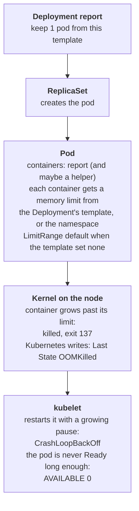

# The report that keeps getting killed

## What happened

Lucia's team runs a small service called `report`. When it starts, it reads
the month's dataset into memory, and then it answers requests for the
month-end report from that memory. It ran for months on a virtual machine
with nobody watching it. Yesterday the team moved it to the shared
Kubernetes cluster, and since then it has not stayed up: `kubectl get pods`
shows `OOMKilled` or `CrashLoopBackOff`, and the RESTARTS column keeps
climbing.

The developer measured the service at about 50 MB on a laptop and says the
code did not change. Both facts are true, and neither one rules out what
is happening. On the laptop nothing limited how much memory the process could
take. In the cluster every container runs inside a memory limit, and the
kernel enforces it the hard way: a container that grows past its limit is
killed on the spot. The code is the same; the box it runs in is smaller.

## The pieces

Kubernetes keeps the cluster looking like the YAML you gave it. The objects
in this ticket, from the top down:

- Deployment `report`: the team's wish, "keep 1 copy of this pod running".
  Its `spec.template` is the blueprint every copy is built from, including
  the containers, their arguments and their `resources`.
- ReplicaSet: created by the Deployment for each version of the blueprint.
  It creates the pod and recreates it when it disappears.
- Pod: one running copy. A pod wraps one or more containers; the READY
  column of `kubectl get pods` reads `ready/total`, so `1/2` means one of
  two containers is fine and the other is not. Each container has its own
  state, its own restart count and its own limits.
- Memory request and limit: two numbers per container under `resources`.
  The request is what the scheduler reserves on a node. The limit is the
  ceiling the node's kernel enforces: cross it and the kernel kills the
  container with exit code 137, which Kubernetes reports as `OOMKilled`
  (out of memory killed). The kubelet then restarts the container, waiting
  longer each time (10s, 20s, 40s ...), which shows as `CrashLoopBackOff`.
- LimitRange: an optional object in a namespace that fills in a default
  request and limit for every new container that did not set its own, and
  can set a `max` that no container may exceed. Platform teams add one to
  their namespace template so that no pod runs without a ceiling. The pod
  shows the filled-in value; the Deployment does not. A pod that asks for
  more than `max` is refused before it exists, and the ReplicaSet records
  `FailedCreate` in the events.



The ticket says the service needs about 50 MB. The question the cluster can
answer is: which container is being killed, what is its limit, and where did
that limit come from.

## Following the trail

Every command here only reads; nothing changes until you decide what to
change. In the workstation the namespace is already set, so plain `kubectl`
(or `k`) works. The full form is shown once.

Start with the pod:

```sh
kubectl -n {{ .Namespace }} get pods
```

Read three columns. READY says how many of the pod's containers are ready
out of how many it has. STATUS alternates between `OOMKilled` (the kernel
just killed a container) and `CrashLoopBackOff` (the kubelet is waiting
before the next restart). RESTARTS counts the kills; a number that grows
while you watch means it happens on every start, not once.

Next, ask the pod for details. You need its name; you do not have to type
it:

- Press TAB: `kubectl describe pod rep` then TAB completes the name.
- Or let a label pick it: `kubectl describe pods -l
  app.kubernetes.io/name=report` describes it without any name.
- Or copy it: select the name in the terminal with the mouse and copy it
  with `Cmd-c` (`Ctrl-Shift-c` on Linux).

```sh
kubectl describe pod <pod-name>
```

Under `Containers:` there is one block per container. In each block read:

- `Args`: what the program was told to do. `--mem-total=48Mi` is the
  dataset the report loads, so the container needs at least that much
  plus the program itself.
- `State` and `Last State`: `Terminated, Reason: OOMKilled, Exit Code:
  137` is the kernel's signature. The block that shows it is the container
  with the problem. A block that says `Running` with `Restart Count: 0` is
  fine, even if it sits in the same pod.
- `Limits` and `Requests`: the ceiling and the reservation this container
  got. Compare the memory limit with the need.

Then find out where that limit came from. The Deployment is the only thing
the team wrote, so print what its template says:

```sh
kubectl get deployment report -o jsonpath='{.spec.template.spec.containers[*].resources}{"\n"}'
```

If the number in the pod matches the number here, the Deployment set it.
If the Deployment prints `{}` (no resources at all) while the pod shows a
limit, something filled it in. That something is a LimitRange in the
namespace:

```sh
kubectl get limitrange
kubectl describe limitrange
```

The table shows `Max`, `Default Request` and `Default Limit` per
resource. Every container created in this namespace without its own
numbers gets the defaults, and no container may ask for more than `Max`.

Last, the real need. The laptop number was a guess; the cluster can measure
the container, but only while it runs. Once the fix is in and the pod stays
up:

```sh
kubectl top pod --containers
```

For the `report` container this prints about 58Mi: the 48Mi dataset plus
the program's own runtime. That is the number the limit has to clear, with
room to spare.

## The fix and why it works

Raise the memory limit of the container that was killed, and set its
request to what it needs. Where you write it depends on where the limit
came from:

- The Deployment wrote the limit: change it there, on that container.

  ```sh
  kubectl set resources deployment/report -c report --requests=memory=64Mi --limits=memory=128Mi
  ```

  For a helper container next to the report, name that container with `-c`
  instead; the report container is fine and keeps its numbers.

- The LimitRange filled it in: change the LimitRange. Explicit numbers in
  the Deployment win over a default, but not over a `max`; a pod asking
  for more than `max` is refused, and `get events` shows `FailedCreate`.
  Raise `max` and the defaults, then restart the rollout, because a
  LimitRange only touches pods created after the change:

  ```sh
  kubectl edit limitrange namespace-defaults
  kubectl rollout restart deployment/report
  ```

Why this works: the Deployment sees a new template (or the restart creates
new pods), the ReplicaSet creates a pod whose container has a ceiling above
its real use, the kernel never kills it, the container stays Running, the
pod stays Ready past `minReadySeconds`, and the Deployment counts it as
available.

Why other moves do not work:

- Deleting the pod: the ReplicaSet creates a new one from the same template,
  in the same namespace, with the same limit. The kill repeats.
- Loading less data: the pod would stay up, but the report would serve part
  of the month. The team asked for room, not for a smaller report.
- Changing the container that was not killed: its block said `Running` with
  zero restarts; nothing there needs to change.

In a real team, also fix the number in the repository's manifest, or the
next deploy brings the old limit back.

## Check your work

```sh
kubectl rollout status deployment/report
kubectl get deployment report
kubectl get pods
kubectl top pod --containers
```

`rollout status` ends with `successfully rolled out`. `get deployment`
shows READY `1/1` and AVAILABLE `1`. `get pods` shows one pod `Running`
with RESTARTS `0`, and it stays that way when you run it again a minute
later. `top` shows the memory each container holds, comfortably under its
new limit. The checks below the terminal turn green, and `kubedrill check`
grades once from the shell.

The habit to keep from this ticket: when a pod restarts, read `Last State`
per container before touching anything. The reason, the exit code and the
limit are all there, and they tell you which container, which cause, and
how far off the number is.
