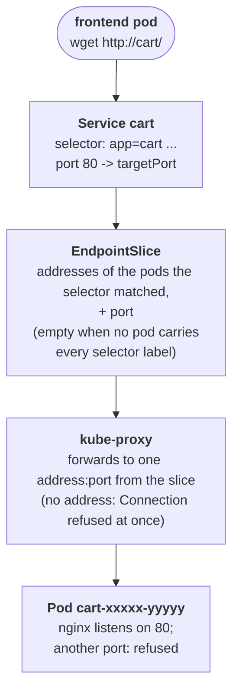

# The cart nobody could reach

## What happened

Dana's team runs the cart, the part of the shop that remembers what a
customer wants to buy. This morning they shipped release 2.3. The release
did not change the program; it tidied the Kubernetes manifests, the YAML
files that describe how the cart runs. The rollout finished, the two cart
pods show `Running`, and nothing crashes. Yet the checkout page spins and
gives up with "cart unavailable", and the frontend, the program that builds
the page, logs that every call to `http://cart/` fails.

`Running` describes one copy of the program: its container started and is
alive. It says nothing about whether anyone can reach it. Between "the
cart is running" and "the frontend gets an answer from the cart" there is
a chain of objects that turns a name into a connection to one pod, and the
release broke a link in that chain. Your job is to walk the chain, find the
link, and repair it.

## The pieces

Kubernetes keeps the cluster looking like the YAML you gave it. You
describe the result, and controllers inside the cluster work until reality
matches. The objects in this ticket, from the caller down to the program:

- Deployment `frontend`: one pod that calls `http://cart/` every 5 seconds
  and writes the result to its log. It stands in for the checkout page.
- Service `cart`: the stable name and address other programs call. A
  Service is three things: a name (`cart`), a selector (a small map of
  labels, for example `app: cart`), and a port mapping (`port: 80`, what
  callers connect to, and `targetPort`, the port on the pod the traffic is
  forwarded to).
- Labels: key-value pairs on every object, for example `app=cart` and
  `tier=web` on the cart pods. They mean nothing by themselves; selectors
  give them meaning by matching them.
- EndpointSlice: a list the cluster writes for each Service with the
  addresses of every pod whose labels match the selector, and the port to
  use. You never write it; you read it to see what the Service resolved to.
- kube-proxy: the component on every node that forwards a connection to
  the Service address on to one of the addresses in the EndpointSlice.
- Deployment `cart`: "keep 2 copies of this pod". Its template carries the
  labels every copy gets and the port the container listens on.
- Pods `cart-...`: the two copies, each running nginx on port 80.



The ticket says the pods are `Running`. So the bottom of the chain works
and the break is in the middle: either the selector matched no pod, or it
matched the pods but the port is not the one nginx listens on. The
EndpointSlice tells you which.

## Following the trail

Every command here only reads; nothing changes until you decide what to
change. In the workstation the namespace is already set, so plain
`kubectl` (or `k`) works. The full form is shown once.

Start with the caller's own words:

```sh
kubectl -n {{ .Namespace }} logs deploy/frontend --tail=5
```

`deploy/frontend` picks the pod of the Deployment for you, so you never
type a pod name. Each line reads `wget: can't connect to remote host
(10.96.x.x): Connection refused`. Two facts: the name `cart` turned into an
address (so DNS works), and the connection was refused at once, not after
a wait (so nothing dropped the packets; something answered "nobody here").

Next, the pods and their labels side by side:

```sh
kubectl get pods --show-labels
```

READY `1/1` and STATUS `Running` for both cart pods, zero restarts. The
LABELS column prints every label, for example
`app=cart,pod-template-hash=...,tier=web`. Keep that line in view.

Now the Service and what it resolved to:

```sh
kubectl get svc cart -o wide
kubectl get endpointslices -l kubernetes.io/service-name=cart
```

`-o wide` adds a SELECTOR column: the labels the Service asks for. The
second command lists the slice of that Service (`-l` picks it by the label
every slice carries, so again no name to type). Read its PORTS and
ENDPOINTS columns. Two shapes are possible, and they tell the variants
apart:

- `<unset>` in both columns: the selector matched no pod. Compare each
  `key=value` of SELECTOR with the LABELS line of the pods; a selector is
  an AND, every entry must be present on the pod with the same value. One
  wrong value or one extra key is enough. Prove it by running the selector
  yourself: `kubectl get pods -l <the SELECTOR text>` prints `No resources
  found` for the broken selector and both pods for a correct one. When the
  extra entry looks like something the pods used to have, `kubectl get rs
  --show-labels` shows the old ReplicaSet of release 2.2 with `0` desired
  and the old labels.
- Both pod addresses listed, but PORTS is a number nginx does not listen on:
  the selector is right and the mapping is wrong. `kubectl describe svc
  cart` prints `TargetPort`, and the pod's own port is in
  `kubectl get pods -l app=cart -o jsonpath='{.items[0].spec.containers[0].ports}'`.

Last, prove the pods serve without the Service. `kubectl port-forward`
opens port 8080 on the workstation straight to one cart pod; run it in the
background and curl it from the same terminal:

```sh
kubectl port-forward deploy/cart 8080:80 &
sleep 1; curl -sS localhost:8080/
kill %1
```

`curl` prints the nginx welcome page. The pod serves; the Service is the
only broken layer. `kill %1` ends the port-forward.

## The fix and why it works

Change one field of the Service `cart`, the one your observation named:

- Selector matched nothing: make every entry of `spec.selector` a label the
  pods carry. Change the entry that differs and nothing else: a value off
  by one character takes
  `kubectl patch svc cart --type=merge -p '{"spec":{"selector":{"app":"cart"}}}'`,
  and a key the new pods no longer carry is removed with `null` in place
  of the value. `kubectl set selector svc cart app=cart` replaces the
  whole map with `app=cart`, which both pods carry.
- Right pods, wrong port: set `spec.ports[0].targetPort` to the port the
  container listens on, `80`, or to the port's name `http`:
  `kubectl patch svc cart --type=json -p '[{"op":"replace","path":"/spec/ports/0/targetPort","value":80}]'`.

Why this works: the EndpointSlice controller watches the Service and
rewrites the slice within a second with the matching pods and the new
port, kube-proxy reads the slice and forwards the Service address to the
pod addresses, and the next `wget` from the frontend reaches nginx.
Nothing restarts, because nothing in the pods was wrong.

Why other moves do not work:

- Restarting or deleting the cart pods: new pods get the same labels and
  the same port, and the Service still points past them.
- Restarting the frontend: the team tried; the caller was never the problem.
- Relabeling pods by hand with `kubectl label pod`: it works until the next
  rollout replaces the pods with the template's labels. A label change
  belongs in the Deployment template, and here the Service is the object
  that drifted.

In a real team, also fix the Service manifest on the release branch, or
the next deploy applies the broken selector or port again.

## Check your work

```sh
kubectl get endpointslices -l kubernetes.io/service-name=cart
kubectl logs deploy/frontend --tail=3
```

The EndpointSlice lists both pod addresses with port `80`, and within 5
seconds the frontend log reads `GET http://cart/ -> ok`. A pod named
`kubedrill-probe-...` may appear for a few seconds: it is the grader
sending one request through the Service, the way the frontend does, and
the grader deletes it. The checks below the terminal turn green, and
`kubedrill check` grades once from the shell.

The habit to keep from this ticket: when pods are Running and a name still
fails, read the EndpointSlice before touching anything. It is the one place
where the selector and the port of a Service meet the pods, and it tells
you which of the two is wrong.
