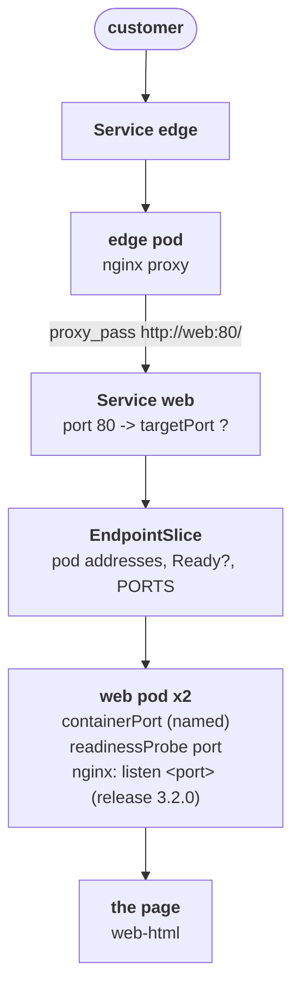

# The release that moved a door

## What happened

Priya's team runs the docs portal: a small website served by nginx, a web
server, under the name `web`. Customers never talk to `web` directly. They
reach the `edge`, another nginx that the platform team runs as a front door
for several teams; the edge forwards each request to `web` and returns the
answer.

Yesterday the docs team shipped release 3.2.0. Part of that release was a
cleanup of the nginx setup, and the release notes say it changed the HTTP
port of the `web` container. The rollout finished, both pods show
`Running`, and the page works on a laptop. Yet every request to the edge
answers `502 Bad Gateway`.

`Running` means the program started. `502` means the edge asked the next
hop for the page and got nothing back. Between a running program and a
served page there is a chain of names and numbers that must agree, and the
release changed one of them. Something in that chain still describes the
old port. Your job is to find which object, and change that one field.

## The pieces

Kubernetes keeps the cluster looking like the YAML you gave it. The objects
in this ticket, from the customer down:

- Service `edge`: the stable name customers reach. It forwards to the edge
  pod.
- Deployment `edge`: one nginx pod configured as a reverse proxy by
  ConfigMap `edge-nginx`. Its config says `proxy_pass http://web:80/`:
  every request goes to the name `web` on port 80.
- Service `web`: one stable name and address (a ClusterIP) in front of the
  web pods. A Service has two ports: `port`, the one clients call (80),
  and `targetPort`, the one it forwards to inside the pod. `targetPort` is
  a number, or the name of a port the pod declares.
- EndpointSlice of `web`: a list the cluster builds for the Service: the
  address of every pod the selector matches, whether each one is Ready, and
  the port number `targetPort` resolved to. kube-proxy, the component on
  every node that makes Service addresses work, forwards only to addresses
  that are Ready and only when the port resolved.
- Deployment `web`: keeps 2 pods from its template. The template declares
  the container's ports (`containerPort`, with a name) and a readiness
  probe, a small HTTP request the node makes to decide whether the pod is
  Ready. A pod that fails its probe stays `Running` and is left out of the
  Service.
- ConfigMap `web-nginx`: the nginx server block of release 3.2.0, mounted
  into each web pod. Its `listen` line is the port nginx really opens.
- ConfigMap `web-html`: the page.



Four places name the port: `listen` in `web-nginx`, `containerPort` in the
pod template, the readiness probe in the pod template, and `targetPort` in
the Service. The release changed `listen` (and, in one version of this
ticket, the port's name). The one that still disagrees is the fault.

## Following the trail

Every command here only reads. In the workstation the namespace is already
set, so plain `kubectl` (or `k`) works; the full form is shown once.

Start at the component that produced the 502, the edge, and read its log:

```sh
kubectl -n {{ .Namespace }} logs deploy/edge
```

Each 502 comes with an `[error]` line such as `connect() failed (111:
Connection refused) while connecting to upstream ... upstream:
"http://10.96.x.x:80/"`. The upstream address is the ClusterIP of Service
`web`, so the edge found the name and the Service refused the connection.
The edge is fine; the problem is at or below Service `web`.

Next, look at the web pods and the Service's EndpointSlice together:

```sh
kubectl get pods
kubectl get endpointslices -l kubernetes.io/service-name=web
```

READY shows `1/1` or `0/1` per pod. In the EndpointSlice line, PORTS is
the port number the Service resolved and ENDPOINTS lists the pod addresses,
Ready or not. This one screen tells the three versions of this ticket
apart:

- READY `1/1` and PORTS `<unset>`: the Service's `targetPort` is a name,
  and no port in the pod carries that name any more.
- READY `1/1` and PORTS `80`: the Service resolved a number, but
  `web-nginx` says `listen 8080`, so the pods refuse port 80.
- READY `0/1`: the readiness probe fails. `kubectl describe pod <web-pod>`
  (press TAB after `web-` to complete the name) ends with Events such as
  `Readiness probe failed: ... connect: connection refused`, and the port
  in that URL is the old one.

Then print the four port values side by side and find the odd one out:

```sh
kubectl get svc web -o jsonpath='{.spec.ports[0].targetPort}{"\n"}'
kubectl get deploy web -o jsonpath='{.spec.template.spec.containers[0].ports}{"\n"}{.spec.template.spec.containers[0].readinessProbe.httpGet.port}{"\n"}'
kubectl get cm web-nginx -o jsonpath='{.data.default\.conf}'
```

`listen` in the ConfigMap is the truth: it is what the release ships and
what nginx opens. Whichever of `targetPort`, the containerPort name or the
probe port disagrees with it is the field to change.

## The fix and why it works

Change that one field, and nothing else. When the Service is the one left
behind, give `targetPort` the pod's port, by name or by number:

```sh
kubectl patch service web --type=json -p '[{"op":"replace","path":"/spec/ports/0/targetPort","value":"http"}]'
```

(`"web"` when the release renamed the port to `web`, `8080` when it moved
to 8080.) When the probe is the one left behind, change the probe port in
the pod template:

```sh
kubectl patch deployment web --type=json -p '[{"op":"replace","path":"/spec/template/spec/containers/0/readinessProbe/httpGet/port","value":"http"}]'
```

`kubectl edit svc web` or `kubectl edit deploy web` does the same by hand.

Why it works: the Service change rewrites the EndpointSlice within a
second, PORTS gets the right number, and kube-proxy starts forwarding to a
port nginx listens on. The probe change starts a rollout: new pods are
probed on the right port, turn Ready, enter the EndpointSlice with
`ready: true`, and kube-proxy forwards to them. Either way the edge's next
`proxy_pass` reaches nginx and the 502 is gone.

Why other moves do not work:

- Deleting the pods: the ReplicaSet recreates them from the same template,
  with the same probe and the same port name.
- Changing `listen` in `web-nginx` back: the portal would answer, but the
  release ships that ConfigMap, so the next deploy restores it and the
  502 returns. It also hides the fact that the Service or the probe still
  describes the old port.
- Restarting or editing the edge: its log already shows it found the
  Service and was refused; the edge has nothing to fix.

## Check your work

```sh
kubectl get endpointslices -l kubernetes.io/service-name=web
kubectl rollout status deployment/web
kubectl run curl --rm -it --restart=Never --image=curlimages/curl:8.14.1 -- curl -sS -m 5 http://edge.{{ .Namespace }}.svc/
```

The EndpointSlice shows a number in PORTS and two addresses, `rollout
status` ends with `successfully rolled out`, and the curl pod prints the
page with `ACME Docs Portal 3.2.0`. A pod named `kubedrill-probe-...` may
appear for a few seconds: it is the grader making the same request through
the edge. The checks below the terminal turn green, and `kubedrill check`
grades once from the shell.

The habit to keep: when a proxy says 502, read the proxy's log for the
upstream error, then read the EndpointSlice of the Service it names. PORTS
and the ready condition of each endpoint tell you whether the fault is in
the Service or in the pods before you open either one.
