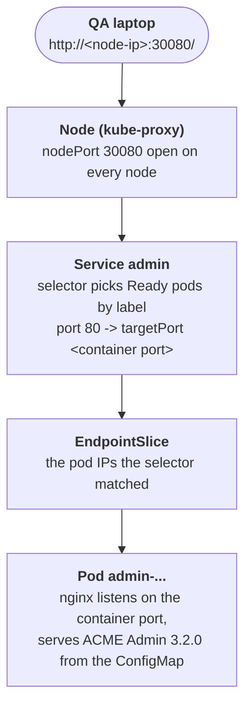

# The admin page nobody can open

## What happened

The admin team built a new version of their back-office page, release
3.2.0, and deployed it to the cluster. Deployed here means one thing only: a
pod runs, and inside it an nginx web server serves the page. Ken from QA
has to sign the build off from her laptop, which can reach the cluster's
nodes but has no `kubectl`. The platform team told her the page would be
on port 30080 of any node. She opens `http://<node-ip>:30080/` and gets
connection refused, on every node.

Nothing is broken. The pod runs and the page is there. What is missing is
the piece that connects a port on the nodes to the pod: a Service. Nobody
created one. Your job is to build it, and to build it so that it points at
exactly the right pod, on the right port.

## The pieces

Kubernetes keeps the cluster looking like the YAML you give it. For this
ticket the objects, from the top down:

- Deployment `admin`: the admin team's wish, "keep 1 copy of this pod
  running". Its `spec.template` is the blueprint of the pod, including the
  container image and the labels every copy gets.
- Pod: one running copy, named after the Deployment plus two random parts,
  for example `admin-5765fbd94d-4mfbr`. It has its own IP on the pod
  network, which changes every time the pod is replaced, and which nothing
  outside the cluster can reach.
- Labels: small key=value tags on the pod, such as
  `app.kubernetes.io/name=admin` and `track=stable`. They are the only way
  another object finds the pod.
- ConfigMap `admin-html` (the page) and ConfigMap `admin-nginx` (the web
  server's config, which says which port nginx listens on). Both are
  mounted into the pod.
- Service `admin`: the object you will create. It has a selector, a list of
  label pairs; every Ready pod that carries all of them becomes an endpoint
  of the Service. It has a `port` (its own) and a `targetPort` (the port
  the container listens on). With `type: NodePort` it also gets a
  `nodePort`: kube-proxy, a program on every node, opens that port on the
  node and forwards every connection to one of the endpoints.



The ticket's connection refused means the chain stops at the first arrow:
no Service, so nothing listens on 30080. Once you create one, each field of
the Service can still break a later arrow: a selector that matches no pod
(no endpoints), a selector that matches too many pods (QA lands on the
wrong page), a wrong targetPort (the endpoint exists but nothing listens
there), or a missing nodePort (a random port opens, not 30080).

## Following the trail

Every command here only reads. In the workstation the namespace is already
set, so plain `kubectl` (or `k`) works; the full form is shown once.

Start with what exists:

```sh
kubectl -n {{ .Namespace }} get deployments,pods,services
```

One Deployment `admin` with READY `1/1`, its pod `Running`, and no Service.
{{- if eq .Vars.canary "true" }}
A second Deployment, `admin-canary`, also runs one pod; the ticket says QA
must not land on it.
{{- end }}
Nothing is wrong yet; something is missing.

Next, the two facts the Service needs. First the labels:

```sh
kubectl get pods --show-labels
```

The LABELS column lists every label of every pod. Note which labels the
`admin` pod carries, and whether any other pod in the namespace carries some
of the same ones. A selector matches a pod when the pod has every pair in
the selector, so you want a set of pairs that the admin pod has and no other
pod has. The pod-template-hash label is not one to use: it changes on every
rollout.

Then the port the container listens on:

```sh
kubectl get deployment admin -o jsonpath='{.spec.template.spec.containers[0].ports}{"\n"}'
```

The output names the `containerPort`. This is the number your `targetPort`
must match. Do not assume 80: the admin team configures nginx through the
`admin-nginx` ConfigMap, and the port is whatever that config says.

After you create the Service, check it the way the cluster sees it:

```sh
kubectl describe service admin
kubectl get endpointslices -l kubernetes.io/service-name=admin
```

`describe` prints Type, Port, TargetPort, NodePort and Endpoints together.
`Endpoints: <none>` means the selector matched no Ready pod. Two addresses
mean it matched two pods. The EndpointSlice is the same information as a
list of the pod IPs the Service forwards to.

## The fix and why it works

Write a Service named `admin` with type NodePort, a selector that matches
only the stable admin pod, port 80, targetPort equal to the container's port
and nodePort 30080. One way to type it, with the values of this episode's
pod filled in from the trail above:

```sh
kubectl apply -f - <<'EOF'
apiVersion: v1
kind: Service
metadata:
  name: admin
spec:
  type: NodePort
  selector:
    app.kubernetes.io/name: admin
    track: stable
  ports:
    - port: 80
      targetPort: <container port>
      nodePort: 30080
EOF
```

Why this works: the EndpointSlice controller sees the new Service, finds the
pods that carry every label of the selector and are Ready, and writes their
IPs into an EndpointSlice. kube-proxy on every node reads it and opens port
30080, forwarding each connection to the pod's IP on the targetPort. nginx
listens there and serves the page from the ConfigMap. Every arrow of the
chain now completes.

Why tempting moves do not work:

- `kubectl expose` with the default port: it copies the container port
  into both port and targetPort, which is right, but it never sets
  nodePort, so the node opens a random port and Ken still gets connection
  refused on 30080. Patch the nodePort afterwards.
- A selector with only `app.kubernetes.io/name: admin`: it matches every
  pod that carries that label. When a second admin pod exists in the
  namespace, half of QA's requests reach the wrong build. Add the pair
  that only the stable pod has.
- Changing the Deployment to listen on 80, or scaling it: the admin team
  owns the workload, and the Service is the object that adapts to the pod,
  not the other way round.

## Check your work

```sh
kubectl describe service admin
kubectl get endpointslices -l kubernetes.io/service-name=admin
kubectl run qa-laptop --rm -i --restart=Never --image=curlimages/curl:8.14.1 -- curl -sS -m 5 http://$(kubectl get nodes -o jsonpath='{.items[0].status.addresses[?(@.type=="InternalIP")].address}'):30080/
```

`describe` shows `Type: NodePort`, `NodePort: 30080/TCP` and one address
under `Endpoints`. The last command plays Ken's laptop: a short-lived pod
on the cluster network asks a node for port 30080, and the answer contains
`<h1>ACME Admin 3.2.0</h1>`. A pod named `kubedrill-qa-laptop-...` may
appear for a few seconds while the checks run: it is the grader making the
same request, and it is deleted afterwards.

The habit to keep from this ticket: before writing a Service, read the pod
labels and the container port from the cluster, and after writing it, read
the Endpoints line before telling anyone it works.
