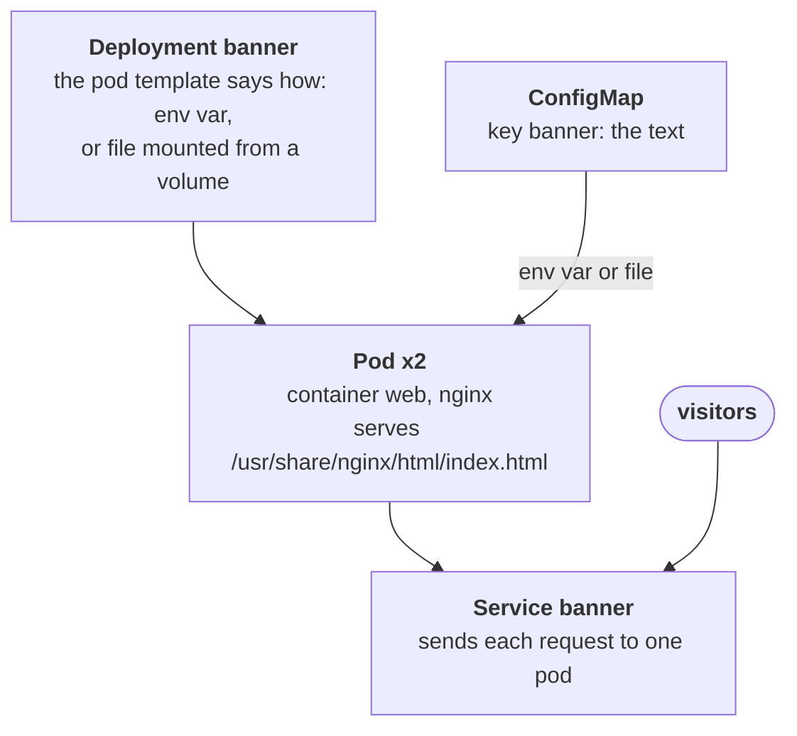

# The banner that would not change

## What happened

Eva's team runs the marketing site. One part of it is the promo banner, a
line of text served by nginx, a web server, from a Kubernetes cluster. The
text is not baked into the program: it lives in a ConfigMap, a small
Kubernetes object that holds configuration values, so the team can change
it without rebuilding anything.

This morning Eva changed the banner from `Summer sale 2025` to `Winter
sale 2026`. She did it the way the runbook says, and when she asked the
cluster for the ConfigMap afterwards, the cluster printed the new text. She
took that as success. Twenty minutes later the page still showed the summer
text.

The cluster printing the new text only means the edit was saved. Saving a
value and having a running program read it are two different steps, and the
second one did not happen. Your job is to find out how the banner program
gets its text, why the new text never reached it, and make it reach it.

## The pieces

Kubernetes keeps the cluster looking like the objects you gave it. The
objects in this ticket, from the top down:

- ConfigMap `{{ .Vars.edited }}`: a dictionary of keys and values. The key
  `banner` holds the text of the banner. This is the object Eva edited.
- Deployment `banner`: the wish "keep 2 copies of this pod running". Its
  `spec.template` is the blueprint of every copy, and the blueprint says how
  the container gets the banner text: as an environment variable, or as a
  file mounted from a ConfigMap, naming the ConfigMap in both cases.
- Pod: one running copy, with one container named `web` that runs nginx.
  Its name is the Deployment name plus two random parts, for example
  `banner-6d4cf56db6-x7k2p`, so you list it instead of guessing it.
- Service `banner`: one stable name in front of the two pods. Each request
  goes to one of them.



The step that matters is the arrow from the ConfigMap into the pod. There
are three ways a container gets a ConfigMap value, and they react to an edit
differently:

- An environment variable (`env` with `valueFrom.configMapKeyRef`): read
  once, when the container starts. An edit afterwards changes nothing in a
  running container.
- A volume that mounts the whole ConfigMap as a directory: the kubelet, the
  agent on each node, refreshes the files within about a minute of an edit.
- A `subPath` mount, which places one key as one file at a given path: it is
  set up once at pod creation and never refreshed.

And one more way for an edit to go nowhere: the Deployment names ConfigMap
A, and the edit went to ConfigMap B.

## Following the trail

Every command here only reads. In the workstation the namespace is already
set, so plain `kubectl` (or `k`) works; the full form is shown once.

Start by listing what exists on both sides, the configuration and the pods:

```sh
kubectl -n {{ .Namespace }} get configmaps
kubectl get pods
```

Read the ConfigMap names: is there one, or more than one that could hold
the banner? Read the AGE of the pods: they are older than Eva's edit. A
pod that started before the edit could only have read the old text at its
start.

Next, read what the API holds in every ConfigMap:

```sh
kubectl get configmaps -o yaml
```

Find the key `banner` in each one. The ConfigMap Eva edited says `Winter
sale 2026`. If another ConfigMap exists and still says `Summer sale 2025`,
note its name.

Now read what one container actually holds. You need a pod name; you do not
have to type it: `kubectl exec banner` then TAB completes it, or copy it
from the NAME column.

```sh
kubectl exec <pod-name> -- env
kubectl exec <pod-name> -- cat /usr/share/nginx/html/index.html
```

`env` prints the environment variables of the container. A line
`BANNER_TEXT=Summer sale 2025` means the text arrived as an env var, and the
container is still holding the value it was given at start. `cat` prints
the file nginx serves; `Summer sale 2025` there means the page itself is
stale, whichever route brought it.

Last, read the route in the blueprint:

```sh
kubectl get deployment banner -o yaml
```

Look at the pod template, under `spec.template.spec`. One of three things is
there, and it names this episode's cause:

- `env` with `valueFrom.configMapKeyRef`: the env var route. The value is
  frozen at container start.
- `volumeMounts` with `subPath: index.html`: the subPath route. The file is
  frozen at pod creation.
- `volumes` with `configMap.name` different from the ConfigMap Eva
  edited: the wrong-name route. The pods read an object nobody changed.

Whatever you find, the shape is the same: the API has the new value, the
container has the old one, and the blueprint explains why the new one never
crossed over.

## The fix and why it works

For the env var and the subPath mount, the running containers cannot pick
the value up. Replace them:

```sh
kubectl rollout restart deployment/banner
```

`rollout restart` stamps the pod template with the current time. The
Deployment sees a changed template, creates new pods and removes the old
ones. Each new container starts now, after the edit, so it reads `Winter
sale 2026` from the ConfigMap when it starts.

For the wrong name, point the blueprint at the ConfigMap the team edits:

```sh
kubectl patch deployment banner -p '{"spec":{"template":{"spec":{"volumes":[{"name":"banner","configMap":{"name":"banner-config-v2"}}]}}}}'
```

That changes the pod template too, so the Deployment rolls out new pods that
mount the right ConfigMap. Writing the new text into the ConfigMap the pods
do mount also works for this cause, because a whole-ConfigMap volume is
refreshed by the kubelet within about a minute.

Why the tempting moves do not work:

- Editing the ConfigMap again: the API already has the new value. Writing it
  a second time does not reach a container that read it once at start or
  holds a frozen subPath file.
- Deleting one pod to "see if it helps": it does help that one pod, since
  the replacement starts after the edit. The other pod stays stale, and the
  Service keeps sending half the visitors to it. Replace all of them, in
  order, with the rollout.
- Changing the Service: it only forwards requests. The text comes from the
  pods.

## Check your work

```sh
kubectl rollout status deployment/banner
kubectl get pods
kubectl exec <pod-name> -- cat /usr/share/nginx/html/index.html
```

`rollout status` ends with `successfully rolled out`, `get pods` shows two
pods `1/1` Running with an AGE of seconds, and `cat` in each new pod prints
`Winter sale 2026`. A pod named `kubedrill-probe-...` may appear for a few
seconds: it is the grader requesting the page through the Service the way a
visitor would. The checks below the terminal turn green.

The habit to keep from this ticket: after a configuration change, verify
what the program reads, not what you wrote. `kubectl get` shows the API;
`kubectl exec` shows the container; the page is made by the second one.
