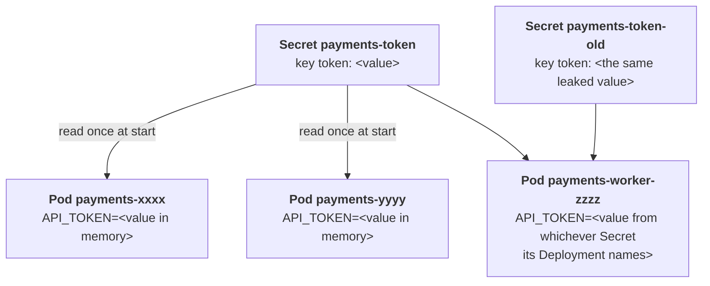

# The token that was pasted into a pull request

## What happened

Priya's team runs the payments service. To talk to the payment provider it
sends a token, a long string that works like a password. The token lives in
the cluster in an object called a Secret. Yesterday someone opened a pull
request that included the whole Secret, token and all, so everyone with
access to the repository could read it. Security does what you always do
with a leaked password: issue a new one, put it everywhere the old one was,
and remove every copy of the old one. The old token stops working at 18:00.

Nothing is broken right now. The pods are running and the status is green.
That is what makes this ticket different from an outage: the job is to
change a value in three places and prove that each place has it, before the
old value stops working. The trap Priya remembers from last time is that a
changed Secret does not reach a running program on its own.

## The pieces

Kubernetes keeps the cluster looking like the objects you describe. The
objects in this ticket, from the value to the program that uses it:

- Secret `payments-token`: a small object with keys and values, here one
  key named `token`. The cluster stores the value base64-encoded (a
  reversible encoding, not encryption), which is why reading it needs
  `base64 -d`.
- Secret `payments-token-old`: Tom's copy, the same value under another
  name. Any copy of a leaked token is a leak.
- Deployment `payments`: the wish "keep 2 copies of the API running". Its
  pod template says: container `api` gets an environment variable
  `API_TOKEN` whose value comes from Secret `payments-token`, key `token`.
- Deployment `payments-worker`: one copy of a background worker with the
  same kind of environment variable. Which Secret it points at is something
  to read, not to assume.
- Pods: the running copies. When a container starts, the kubelet reads the
  Secret once and hands the value to the process as an environment
  variable. From then on the process has its own copy in memory.



Three copies of the value, plus Tom's: the Secret, the API pods, the worker
pod, the copy. The ticket is done when the first three hold the new value
and the fourth is gone.

## Following the trail

Every command here only reads. In the workstation the namespace is already
set, so plain `kubectl` (or `k`) works; the full form is shown once.

Start with what exists:

```sh
kubectl -n {{ .Namespace }} get secrets,deployments
```

Two Secrets and two Deployments. Now read the value the cluster stores. The
`-o jsonpath` flag picks one field out of the object, and `base64 -d`
decodes it:

```sh
kubectl get secret payments-token -o jsonpath='{.data.token}' | base64 -d
```

It prints the leaked value, and no newline after it: the prompt comes right
after the token. Next, the value a running pod has. `exec` runs a command
inside a container; `deploy/payments` lets kubectl pick one of the
Deployment's pods so you do not type a pod name; `printenv API_TOKEN` prints
that one environment variable:

```sh
kubectl exec deploy/payments -- printenv API_TOKEN
kubectl exec deploy/payments-worker -- printenv API_TOKEN
```

Same value in both. Then the question that tells this episode apart from
the next one: which Secret does each Deployment read? The field is
`secretKeyRef.name` under the container's `env`; a `jsonpath` that walks to
it prints one line per Deployment:

```sh
kubectl get deployment payments payments-worker -o jsonpath='{range .items[*]}{.metadata.name}{" reads "}{.spec.template.spec.containers[0].env[0].valueFrom.secretKeyRef.name}{"\n"}{end}'
```

Either both read `payments-token`, or the worker reads
`payments-token-old`. In the second case the worker is tied to the copy you
are about to delete, and that changes the order of the fix. The same fact is
visible in `kubectl describe deployment payments-worker`, under
`Environment`, as `API_TOKEN: <set to the key 'token' in secret
'payments-token-old'>`.

Last, the label the audit looks for:

```sh
kubectl get secret payments-token --show-labels
```

No `rotated` label yet.

## The fix and why it works

Four steps, in this order.

1. Rebuild the Secret from a file. Write the token with `printf '%s'`, which
   writes exactly the characters and nothing else; `echo` would add a
   newline at the end, and `--from-file` keeps every byte of the file, so
   the provider would receive `token\n` and reject it. `kubectl create
   secret generic ... --from-file=token=token.txt` builds the Secret from
   the file, `--dry-run=client -o yaml` prints the manifest instead of
   creating it, and `kubectl apply -f -` writes that manifest over the
   existing Secret. The token never sits in a file you keep.

   ```sh
   printf '%s' '{{ .Vars.new_token }}' > token.txt
   kubectl create secret generic payments-token --from-file=token=token.txt --dry-run=client -o yaml | kubectl apply -f -
   kubectl label secret payments-token rotated={{ .Vars.rotated }} --overwrite
   rm token.txt
   ```

2. Point the worker at the right Secret, when it reads the copy. Change
   `name: payments-token-old` to `name: payments-token` under its
   `secretKeyRef`, with `kubectl edit deployment payments-worker` or the
   `patch` command of the solution. When it already reads `payments-token`,
   there is nothing to change here.

3. Replace the pods. The Secret now holds the new value, but the pods still
   have the old one in memory, because the environment was built when they
   started. A Deployment replaces its pods only when its pod template
   changes; `rollout restart` changes a timestamp annotation in the
   template, which is enough. New pods start, read the Secret again, and get
   the new value; the old pods are stopped.

   ```sh
   kubectl rollout restart deployment/payments deployment/payments-worker
   ```

4. Delete Tom's copy, last. After step 2 nothing reads it any more, so
   removing it cannot stop a pod from starting.

   ```sh
   kubectl delete secret payments-token-old
   ```

Why the tempting shortcuts fail:

- Changing the Secret and stopping there: `printenv` in the pods still
  prints the old value. That is the "hours on the old value" Priya
  remembers.
- Deleting the copy first, when the worker reads it: the worker's next pod
  cannot build its environment and stops at `CreateContainerConfigError`.
- Writing the file with `echo`: the Secret holds the token plus a newline,
  `base64 -d` prints the value and then a blank line, and every call to the
  provider fails with an invalid token.

## Check your work

```sh
kubectl rollout status deployment/payments
kubectl rollout status deployment/payments-worker
kubectl get secret payments-token -o jsonpath='{.data.token}' | base64 -d
kubectl exec deploy/payments -- printenv API_TOKEN
kubectl exec deploy/payments-worker -- printenv API_TOKEN
kubectl get secrets --show-labels
```

Both rollouts end with `successfully rolled out`. The same new token prints
three times, from the Secret and from a new pod of each Deployment. The
Secret list shows `payments-token` with `rotated={{ .Vars.rotated }}` and
no `payments-token-old`. The checks below the terminal turn green, and
`kubedrill check` grades once from the shell.

The habit to keep: after changing a Secret or a ConfigMap that feeds an
environment variable, restart the rollout and read the value from inside a
new pod. The Secret is what the cluster stores; the pod is what the program
uses; they are not the same copy.
