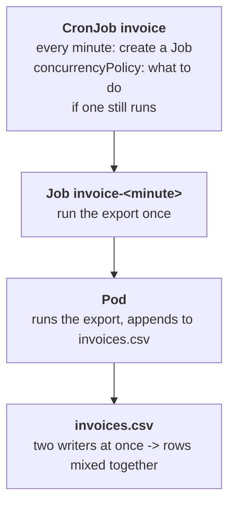

# The export that ran twice

## What happened

Priya's billing team runs an export every night: a small program reads the
day's invoices and appends them to a file, `invoices.csv`, that finance uses
to close the day. Last night the file came out with rows from two runs mixed
together, and the log showed two `start` lines for the same night. Nothing
reported an error, because each run, on its own, did exactly what it was
told. The question is not "what failed" but "why did two runs touch the file
when only one should".

The team copied the setup into the namespace `{{ .Namespace }}` and made it
run every minute instead of every night, so the problem shows up within two
minutes instead of once a day.

## The pieces

Kubernetes keeps the cluster looking like the YAML you gave it. For work
that runs on a timetable, three objects are stacked:

- CronJob: "on this schedule, run this". Its `schedule` uses the classic
  cron format; `*/1 * * * *` means every minute. Each time the schedule
  fires (a tick), the CronJob creates a Job. Three fields of its `spec`
  matter here:
  - `concurrencyPolicy`: what a tick does when the previous Job is still
    running. `Allow` (the default) starts another one next to it,
    `Replace` stops the running one and starts a new one, `Forbid` skips
    the tick.
  - `suspend`: `true` stops new ticks. Jobs already running continue.
  - `successfulJobsHistoryLimit` and `failedJobsHistoryLimit`: how many
    finished Jobs are kept, so you can read their logs later.
- Job: "run this to completion once". It is named after its CronJob plus a
  number that encodes the scheduled minute, for example
  `invoice-29885665`. It creates a pod and waits for it to finish.
- Pod: the running copy of the export program. Its log is the export log
  from the ticket.



The policy of one CronJob only looks at its own Jobs. If anything else also
creates Jobs that run the same export, the policy cannot see them.

## Following the trail

Every command here only reads. In the workstation the namespace is already
set, so plain `kubectl` (or `k`) works; the full form is shown once.

List the three layers together. The `-l` selector picks every object that
carries the team's label, so you do not need any name:

```sh
kubectl -n {{ .Namespace }} get cronjobs,jobs,pods -l app.kubernetes.io/name=invoice
```

How many CronJobs are listed? Read SCHEDULE, SUSPEND and ACTIVE for each.
Then watch the Jobs live for two minutes; new lines appear as Jobs start and
finish (Ctrl-C stops it):

```sh
kubectl get jobs --watch
```

At the moment a new Job appears, look at the one before it. Three different
pictures are possible: it is still `Running` next to the new one, it
disappears, or a Job with a different name prefix starts in the same minute.
The events tell the same story from the controller's side:

```sh
kubectl get events --sort-by=.lastTimestamp
```

`Created job` comes from a CronJob tick, `Deleted job` means the CronJob
removed a running Job, and `Killing ... Stopping container export` is that
pod being stopped. Read the policy and the suspend flag of every CronJob:

```sh
kubectl get cronjobs -o custom-columns=NAME:.metadata.name,POLICY:.spec.concurrencyPolicy,SUSPEND:.spec.suspend,SCHEDULE:.spec.schedule
```

Read a run's log with `kubectl logs job/<job-name>`, taking the name from
`get jobs` (TAB completes it). A complete run prints `start`, the batches
and `done`.

## The fix and why it works

Change the CronJob, not the Jobs or pods: they are recreated every minute
from the CronJob's template.

```sh
kubectl patch cronjob invoice --type=merge -p '{"spec":{"concurrencyPolicy":"Forbid"}}'
```

With `Forbid`, a tick that finds the previous run still active creates
nothing, so one export owns the file from `start` to `done`. If another
CronJob also runs the export on the same schedule, suspend it (or remove it):

```sh
kubectl patch cronjob invoice-legacy --type=merge -p '{"spec":{"suspend":true}}'
```

Neither change stops a Job that is already running. Look at `get jobs`, and
if more than one is active, delete the extra one with
`kubectl delete job <job-name>`.

Why other moves do not work:

- Deleting the pods or Jobs only: the next tick creates new ones with the
  same behavior.
- `Replace`: it avoids two runs at once by killing the one in progress,
  which leaves the file half written.
- Suspending `invoice`: no more overlap, and no more export either.

## Check your work

```sh
kubectl get cronjobs -l app.kubernetes.io/name=invoice
kubectl get jobs --watch
```

Only `invoice` shows SUSPEND `False`, and over the next ticks at most one Job
is `Running` at a time. To run the export once on demand from the same
template, `kubectl create job invoice-manual --from=cronjob/invoice` creates
a Job outside the schedule; the policy does not cover it, so start it only
when no run is active. The checks below the terminal turn green, and
`kubedrill check` grades once from the shell.

The habit to keep from this ticket: when something ran twice, count the
writers before you read the code. List every object that can start the work
and watch two ticks.
