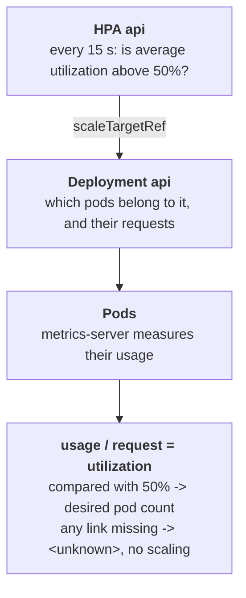

# The autoscaler that could not see

## What happened

Priya's team runs `api`, a web service. One copy of it is enough on a quiet
day, but not under heavy traffic. So the team added an autoscaler: a rule
that says "when the copies work harder than half of what they asked for,
start more of them, up to 4". In yesterday's load test the service got
slower and slower, and the autoscaler never started a second copy.

The autoscaler exists, the cluster accepted it, and no error appeared when
it was created. Existing is not working: the autoscaler needs a number to
compare with its rule, and it shows `<unknown>` where that number should be.
Your job is to find which link in the chain that produces the number is
broken.

## The pieces

- Deployment `api`: the team's wish, "keep these copies (pods) running".
  Its pod template describes each copy, including the container and its
  resources.
- Pod: one running copy. Its name is the Deployment name plus random parts,
  so you list it instead of guessing it.
- Resource request: in the container's `resources.requests`, the amount of
  CPU and memory the container asks the cluster to reserve. `50m` CPU means
  50 millicores, 5% of one CPU core.
- metrics-server: a cluster component that measures how much CPU and memory
  each pod uses right now. `kubectl top pods` shows its numbers.
- HorizontalPodAutoscaler (HPA) `api`: the autoscaler. `scaleTargetRef` names
  the Deployment it resizes, `metrics` names the resource it watches (CPU or
  memory) and the target, here 50% utilization.
- Utilization: usage divided by request. A pod using 25m CPU with a 50m
  request is at 50%. Without a request there is nothing to divide by.



## Following the trail

Every command here only reads. In the workstation the namespace is already
set, so plain `kubectl` (or `k`) works; the full form is shown once.

```sh
kubectl -n {{ .Namespace }} get hpa api
```

REFERENCE is the object the HPA resizes; it should say `Deployment/api`.
TARGETS shows the metric, the current value and the target: `cpu:
<unknown>/50%` means no current value. REPLICAS is how many pods the HPA
sees.

```sh
kubectl describe hpa api
```

`describe` ends with two blocks. `Conditions` holds the controller's verdict:
`AbleToScale` says whether it could find and read the target, `ScalingActive`
whether it could compute a pod count; a False line carries a message. The
`Events` below repeat the reason with a count. The messages to look for are
`not found` (the target does not exist) and `missing request for cpu` or
`missing request for memory` (a container has no request for the resource
the HPA divides by). The name `api` is short, so you type it; for longer
names, TAB completes them.

```sh
kubectl get deployment api -o jsonpath='{.spec.template.spec.containers[*].resources}'
kubectl top pods
```

The first prints the requests of every container in the pod template; compare
them with the resource the HPA watches. The second proves metrics-server
measures the pods, so that link is not the broken one.

## The fix and why it works

Repair the one link `describe hpa` names, and keep the team's rule (CPU, 50%,
1 to 4 pods):

- Missing CPU request: `kubectl set resources deployment/api -c api
  --requests=cpu=50m`. The Deployment starts a new pod with the request, and
  the HPA divides its usage by 50m.
- Target that does not exist: change the HPA `spec.scaleTargetRef.name` to
  `api` with `kubectl edit hpa api` or `kubectl patch`. The HPA finds the
  Deployment and reads its pods.
- Metric on memory while only CPU is requested: change the HPA metric
  `spec.metrics[0].resource.name` to `cpu`. The team sized and requested CPU,
  and the HPA now divides by that request.

Why other moves do not work: restarting the pods brings back the same
template; scaling the Deployment by hand works until the HPA, once repaired,
takes over the count again; creating a Deployment with the name the HPA asks
for scales a copy that receives no traffic; adding a memory request when the
team wants CPU makes the HPA react to the wrong resource.

## Check your work

```sh
kubectl get hpa api --watch
```

Within about a minute TARGETS changes from `<unknown>/50%` to a number such
as `cpu: 0%/50%`. Stop with Ctrl-C. `kubectl describe hpa api` now shows
`ScalingActive True ValidMetricFound`. The first minute of `<unknown>` after
a new pod starts is normal: metrics-server has not measured it yet.

The habit to keep: an object that exists is not an object that works. Read
its Conditions, and for anything expressed as a percentage, find what it is
a percentage of.
