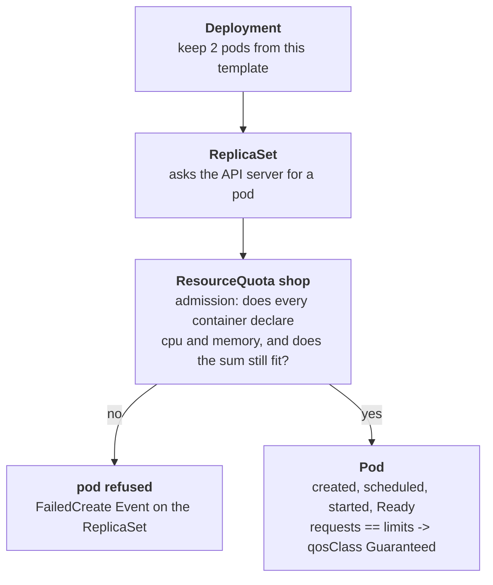

# Five pods, one budget

## What happened

The shop runs three small web services: `storefront`, `catalog` and
`cart`. The platform team was told the namespace (the shop's own area of
the cluster) has a fixed budget of CPU and memory, so they set a hard cap
on it. Right after that, every service showed `0` ready and nothing came
back, even after a restart.

Nothing crashed. The cluster refused to start the services at all, because
they never said how much CPU and memory they need, and a capped namespace
cannot count what nobody declared. The ticket asks for two things: declare
the sizes so the services fit the budget, and declare them in the way that
makes the node protect them first when memory runs short.

## The pieces

- Deployment: "keep N copies of this pod running". Its pod template is the
  blueprint, and each container in it may declare `resources`.
- ReplicaSet: created by the Deployment. It is the object that actually
  asks the API server to create each pod, so a refusal is written on it.
- Pod: one running copy, with one or more containers.
- Requests: the CPU and memory a container reserves. The scheduler uses
  them to pick a node. CPU is counted in cores or millicores (`250m` is a
  quarter of a core), memory in bytes (`256Mi`).
- Limits: the most a container may use. Above its CPU limit it is slowed
  down; above its memory limit it is killed.
- ResourceQuota `shop`: the budget. It adds up the requests and limits of
  every pod in the namespace and refuses a new pod that would go over. A
  quota on CPU and memory also refuses a pod that declares nothing.
- QoS class: a label the cluster gives each pod from its resources.
  `Guaranteed` (every container has requests equal to limits) is evicted
  last when a node runs out of memory; `Burstable` and `BestEffort` go
  first.



## Following the trail

Every command here only reads. In the workstation the namespace is already
set, so plain `kubectl` works; the full form is shown once.

```sh
kubectl -n {{ .Namespace }} get deploy,rs,pods
```

The Deployments show `0/2` or `0/1` READY and there are no pods at all.
The ReplicaSets show DESIRED `2` and CURRENT `0`: they wanted pods and got
none. A pod that never existed cannot be described, so ask the ReplicaSet.
You do not need its random name: a label picks it.

```sh
kubectl describe rs -l app.kubernetes.io/name=catalog
```

At the bottom, the Events repeat `FailedCreate` with `forbidden: failed
quota: shop: must specify limits.cpu for: ...; limits.memory for: ...`.
The list after `for:` names every container that declared nothing. Count
them: a Deployment with two containers needs both sized.

```sh
kubectl describe resourcequota shop
```

`Hard` is the budget, `Used` is what admitted pods already take. Today
`Used` is `0` everywhere, which confirms that nothing got in.

Now do the arithmetic before changing anything: count the containers
across all replicas (one per pod, more when a pod has a sidecar), and
divide the budget among them.

## The fix and why it works

Give each container the same value for request and limit, for CPU and for
memory. One command per Deployment sets every container of its template:

```sh
kubectl set resources deployment/storefront --requests=cpu=250m,memory=256Mi --limits=cpu=250m,memory=256Mi
```

Repeat it for `catalog` and `cart`. Each Deployment gets a new template,
creates a new ReplicaSet, and that ReplicaSet asks for pods that now
declare their sizes. The quota adds them up; at 250m and 256Mi per
container, 5 single-container pods take 1250m and 1280Mi, and 7 containers
take 1750m and 1792Mi, which fits every budget this ticket uses. Because
requests equal limits, every pod is `Guaranteed`.

Why other moves do not work:

- Restarting or deleting: the new pods come from the same template and
  are refused the same way.
- Setting only requests: the quota also caps limits, so the pod is still
  refused.
- Large values such as `500m` per pod: the first pods fit, the next ones
  are refused with `exceeded quota`, and some Deployments stay short.
- Raising the quota: it works, and it spends money the ticket says the
  shop does not have.

Another route is a LimitRange, an object that fills in missing requests
and limits at admission. With `default` equal to `defaultRequest`, every
container that declares nothing comes out Guaranteed.

## Check your work

```sh
kubectl get deploy
kubectl get pods -o custom-columns=NAME:.metadata.name,QOS:.status.qosClass,PHASE:.status.phase
kubectl describe resourcequota shop
```

Every Deployment shows its full READY count, every pod says `Guaranteed`
and `Running`, and the quota's `Used` column is now below `Hard`. The
habit to keep: when a Deployment has no pods at all, the answer is on the
ReplicaSet, one layer up.
