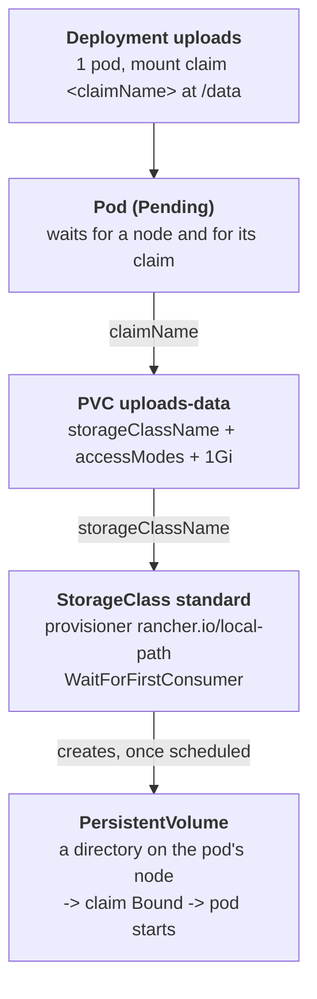

# The upload service that waited for a disk

## What happened

Noor's team runs `uploads`, a small service that stores the images
customers attach to their listings. The files must survive a restart, so the
service keeps them on a disk that Kubernetes provides, not inside the
container. Yesterday the team copied the manifests to a new cluster and
applied them. The pipeline said "green". Since then the service has not
started, and the disk request shows `Pending`.

"Green" only meant the cluster accepted the YAML. Getting a disk is a
separate step that happens later, done by a different program, and it can
fail quietly: the request just stays Pending. Your job is to find out why
this request was never satisfied.

## The pieces

- Deployment `uploads`: "keep 1 pod running from this template". The
  template says the container mounts a volume at `/data`, and that the volume
  comes from the claim named in `claimName`.
- Pod: the running copy. A pod that needs a volume cannot be placed on a
  node, or started, until its volume exists.
- PersistentVolumeClaim (PVC) `uploads-data`: a request for storage, "1Gi,
  of this class, with this access mode". `Pending` means no volume is
  attached to the request yet; `Bound` means one is.
- StorageClass: a kind of storage the cluster offers, and the program (the
  provisioner) that creates volumes of that kind. This cluster has one,
  `standard`, served by `rancher.io/local-path`, which creates a directory
  on one node.
- PersistentVolume (PV): the actual volume the provisioner creates for a
  claim. You never create it here; it appears when provisioning works.
- Access mode: who may mount the volume at once. `ReadWriteOnce` (RWO) means
  one node; `ReadWriteMany` (RWX) means many nodes at the same time, which
  needs a shared network filesystem.
- `volumeBindingMode: WaitForFirstConsumer`: the class waits until a pod
  that uses the claim is scheduled, so it creates the volume on the node the
  pod runs on. Until then a healthy claim is Pending on purpose.



Any link in this chain can break: the pod can name a claim that does not
exist, the claim can name a class that does not exist, or the class can be
asked for something its provisioner cannot make.

## Following the trail

Every command here only reads. In the workstation the namespace is already
set, so plain `kubectl` (or `k`) works; the full form is shown once.

First, what storage does this cluster offer?

```sh
kubectl get storageclass
```

`NAME` is what a claim must write in `storageClassName`, `PROVISIONER` is
the program that creates volumes, and `VOLUMEBINDINGMODE` says when.
StorageClasses belong to the whole cluster, not to a namespace.

Then the claim and the pod:

```sh
kubectl -n {{ .Namespace }} get pvc,pods
kubectl describe pvc uploads-data
```

`get pvc` shows the claim's `STATUS` and `STORAGECLASS`; `ACCESS MODES`
stays empty until the claim is Bound, so read what the claim asks for with
`kubectl get pvc uploads-data -o jsonpath='{.spec.accessModes}'`.
`describe pvc` ends with Events, notes the cluster wrote about this claim:

- `ProvisioningFailed ... storageclass ... not found`: the claim asks for a
  class this cluster does not have. Compare with `get storageclass`.
- `ProvisioningFailed ... only supports ReadWriteOnce`: the provisioner ran
  and refused the access mode.
- only `WaitForFirstConsumer`: the claim is fine and waits for a pod. Then
  look at the pod.

Describe the pod without typing its name, through its label (or press TAB
after `kubectl describe pod up`):

```sh
kubectl describe pod -l app.kubernetes.io/name=uploads
```

The `Volumes` section shows `ClaimName`, the claim the pod asks for, and the
`FailedScheduling` Event says why the scheduler found no node. If it says a
claim is `not found`, compare that name with `uploads-data` letter by letter.
A pod with no Events at all is also an answer: the scheduler chose a node
and waits for the volume the provisioner could not create, so the reason is
in the claim's Events.

## The fix and why it works

Fix the link that is broken, and only that one.

If the pod names the wrong claim, change `claimName` in the Deployment:

```sh
kubectl patch deployment uploads --type=json -p '[{"op":"replace","path":"/spec/template/spec/volumes/0/persistentVolumeClaim/claimName","value":"uploads-data"}]'
```

The Deployment creates a new pod that uses `uploads-data`; the scheduler
places it, local-path creates the volume on that node, the claim turns Bound
and the pod starts.

If the claim asks for a class or an access mode the cluster cannot give, the
claim itself must change. A claim's spec cannot be edited after creation, so
save a copy, delete it and create it again with the same name,
`storageClassName: standard` and `accessModes: [ReadWriteOnce]`:

```sh
kubectl get pvc uploads-data -o yaml > uploads-data.yaml
kubectl delete pvc uploads-data
```

then `kubectl apply -f` a corrected claim. This is safe only because the
claim never bound, so there is no data to lose. The Pending pod asks for the
claim by name, so it finds the new one on its own.

Why other moves do not work:

- Deleting or restarting the pod: the new pod asks for the same claim and
  waits the same way.
- Editing the claim: the API server refuses, `spec is immutable after
  creation`.
- Creating a claim with the name the pod asks for: the pod starts, but
  `uploads-data` stays Pending and the data goes to a claim nobody expects.

## Check your work

```sh
kubectl rollout status deployment/uploads
kubectl get pvc uploads-data
kubectl exec deploy/uploads -- sh -c 'echo test > /data/probe.txt && cat /data/probe.txt'
```

The claim shows `Bound` with a `pvc-...` volume, the pod is `1/1` Running,
and the exec prints `test`: the pod writes to the volume. The checks below
the terminal turn green, and `kubectl get pv` now lists the volume local-path
created.

The habit to keep from this ticket: a Pending claim is a question, not an
answer. Read its Events, then read the Events of the pod that uses it.
