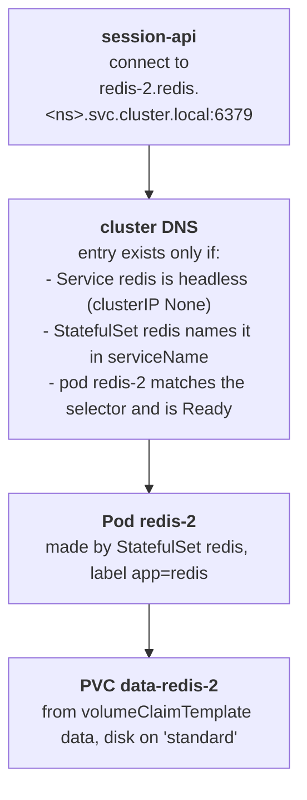

# Three redis nodes that answer by name

## What happened

Yuki's team runs `session-api`, the program that remembers who is logged
in. It stores each login in redis, a small in-memory database, and it
spreads the logins over three redis nodes. It decides itself which node
holds which login, so it must reach each node by a fixed name, written in
its configuration: `redis-0.redis.{{ .Namespace }}.svc.cluster.local`, then
`redis-1...` and `redis-2...`.

session-api is already running, and its log says none of the three names
resolve: the cluster's DNS, the phone book that turns names into addresses,
has no entry for them. Nothing is broken; the redis nodes were never built.
Your job is to build them so that the three names exist and answer.

## The pieces

Kubernetes keeps the cluster looking like the YAML you give it. The objects
in this ticket:

- Pod: one running copy of a program. A pod made by a Deployment gets a
  random name (`session-api-6fb88d45cf-ql4br`) and a new one each time it is
  replaced, which is fine for a web server and useless when a client wants
  "node 2".
- StatefulSet `redis`: like a Deployment, but each pod gets a fixed name
  made of the StatefulSet name and a number, `redis-0`, `redis-1`,
  `redis-2`. A replaced `redis-2` is called `redis-2` again.
- volumeClaimTemplate `data`: a form inside the StatefulSet. For each pod it
  files a PersistentVolumeClaim (a request for disk) named
  `data-redis-0`, `data-redis-1`, `data-redis-2`. The claim follows the
  name, so a restarted `redis-2` gets its own disk back with its data.
- StorageClass `standard`: the cluster's disk supplier. It creates the disk
  when the pod that needs it is placed on a node.
- Service `redis`: a name in DNS for a group of pods, chosen by a label
  selector (`app=redis`). A normal Service gets one virtual address and
  spreads requests over the pods. A headless Service (`clusterIP: None`)
  has no virtual address; instead DNS gets one entry per Ready pod.
- `spec.serviceName`: the field of the StatefulSet that names its headless
  Service. Together they make the entry `<pod>.<service>.<namespace>.svc.cluster.local`.
- Readiness probe: a command the node runs in the container
  (`redis-cli ping`, which answers `PONG`). Only a Ready pod gets its DNS
  entry.



## Following the trail

Every command here only reads. In the workstation the namespace is already
set, so plain `kubectl` (or `k`) works; the full form is shown once.

Start with what the client needs and what it sees:

```sh
kubectl -n {{ .Namespace }} get configmap session-api-config -o yaml
kubectl logs deploy/session-api --tail=4
```

The ConfigMap lists the three names; the log says each one `does not
resolve`. Read one name right to left: `svc.cluster.local` is the cluster's
Service domain, `{{ .Namespace }}` the namespace, `redis` the Service,
`redis-2` the pod. So you need a Service `redis` and a pod named `redis-2`,
and only a StatefulSet named `redis` makes a pod with that name.

List what exists:

```sh
kubectl get statefulset,pods,pvc,svc
```

Only the session-api pod: nothing called `redis` yet. Read the fields you
are about to write; `kubectl explain` prints the official description:

```sh
kubectl explain statefulset.spec.serviceName
kubectl explain statefulset.spec.volumeClaimTemplates
kubectl explain statefulset.spec.podManagementPolicy
```

The last line of the ticket differs between episodes: it asks for the pods
to start in order, all at once, or with the team's configuration file from
ConfigMap `redis-config`. Read it before you write the YAML.

## The fix and why it works

Write two objects in one file and apply it: a Service `redis` with
`clusterIP: None`, port 6379 and selector `app=redis`, and a StatefulSet
`redis` with `serviceName: redis`, 3 replicas, the label `app=redis` on its
pods, the `redis:7.4-alpine` image, the readiness probe `redis-cli ping`
and a volumeClaimTemplate `data` of 100Mi on `standard` mounted at `/data`.
Then add the setting from the last line of the ticket:
`podManagementPolicy` (`OrderedReady` or `Parallel`), or a ConfigMap volume
and the arguments `redis-server /usr/local/etc/redis/redis.conf`.

```sh
kubectl apply -f redis.yaml
kubectl rollout status statefulset/redis
```

Why this works: the StatefulSet creates `redis-0` first, files the claim
`data-redis-0`, the disk is made when the pod lands on a node, redis starts,
`redis-cli ping` answers `PONG`, the pod turns Ready, and its address joins
the Service's endpoint list. Because the Service is headless and the
StatefulSet names it, DNS adds `redis-0.redis.{{ .Namespace }}.svc.cluster.local`.
With `OrderedReady` the same happens for `redis-1` only after `redis-0` is
Ready; with `Parallel` all three start together.

Why the tempting moves do not work:

- A Deployment named `redis`: its pods are called `redis-<random>`, so no
  `redis-2` ever exists.
- A normal Service (with a cluster IP): `redis.<ns>.svc` resolves, but to
  one shared address, and `redis-2.redis...` still does not.
- Fixing a mistake in `serviceName` or `volumeClaimTemplates` with an edit:
  these fields cannot change on an existing StatefulSet. The API refuses the
  edit; recreate the StatefulSet instead, and the claims are reused.

## Check your work

```sh
kubectl get statefulset,pods,pvc,svc
kubectl get endpointslices -l kubernetes.io/service-name=redis -o wide
kubectl exec deploy/session-api -- nslookup redis-2.redis.{{ .Namespace }}.svc.cluster.local
kubectl logs deploy/session-api --tail=4
```

`READY 3/3`, three claims `Bound`, `CLUSTER-IP None`, three addresses in
the EndpointSlice. `nslookup` prints the address of pod `redis-2`, and
within 10 seconds session-api logs `3 of 3 redis nodes reachable, sessions
stored`. A pod named `kubedrill-probe-...` may appear for a few seconds: it
is the grader running `redis-cli ping` against `redis-2` by name, the way
session-api does.

The habit to keep: read a DNS name right to left before building anything.
Each part names an object, and the name tells you which kind of object can
produce it.
